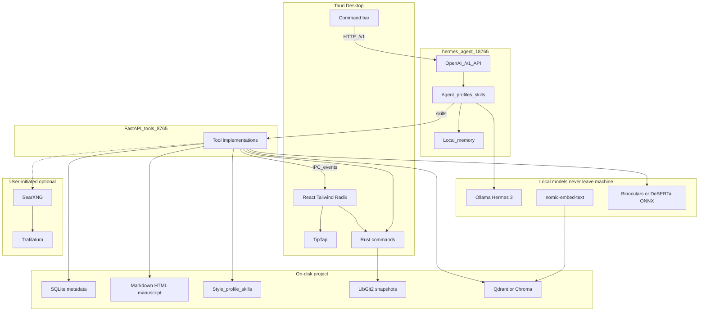

# Architecture

Purpose: describe AegisDraft’s local-first system design—process boundaries, data model, RAG, integrity, and the **hermes-agent** loop that sits above them.

## Golden rule

Everything sensitive stays on the author’s machine: manuscript files, SQLite metadata, vector index, Ollama models, detector weights, hermes memory, style profile, skills, and agent thought traces. Network is optional and user-initiated (web similarity only).

## System overview

**hermes-agent** orchestrates RAG and integrity by calling AegisDraft tools (via skills). It does not replace storage or the TipTap editor. The React UI reflects mutations through IPC events.

Ports and lifecycle: [HERMES-RUNTIME.md](HERMES-RUNTIME.md).

## Process boundaries

| Process | Owns |
| :--- | :--- |
| **Tauri webview (React)** | Binder, TipTap, corkboard, outliner, inspector, command bar, report UI |
| **Rust core** | File I/O, SQLite access, LibGit2 snapshots, IPC commands, process lifecycle (start/stop hermes + gateway) |
| **hermes-agent (`:18765`)** | Multi-step planning, profiles, memory, skill execution loop |
| **FastAPI tool gateway (`:8765`)** | TOOLS.md implementations, LlamaIndex retrieval helpers, Trafilatura, detectors |

UI updates are events (`binder_changed`, `highlight_range`, `report_attached`, `agent_log`). See [TOOLS.md](TOOLS.md).

## Agent loop

1. User intent (command bar, “Run Integrity Check”, scene highlight + prompt)
2. UI calls hermes-agent `/v1` with the matching **profile** (App Controller, Deep Continuity, Integrity, World-Builder)
3. hermes-agent + Hermes 3 plan steps and invoke **skills**
4. Skills HTTP to the tool gateway → mutate SQLite / Markdown / highlights / reports / style store
5. Events refresh the React UI
6. Skill policy + UI enforce **confirm** on destructive or networked tools; hermes runtime caps runaway loops

Agents: [AGENTS.md](AGENTS.md). Runtime details: [HERMES-RUNTIME.md](HERMES-RUNTIME.md).

## Data model (Scrivener-style folder project)

A project is a **folder** (`.aegis` or similar analogue to `.scriv`), not a monolithic binary.

| Store | Contents |
| :--- | :--- |
| **SQLite** | Binder tree, labels, status, keywords, character/location sheets, project settings, rubric definitions |
| **Markdown / HTML files** | Scene and research body text—if the app dies, authors still have readable files |
| **Style / skills / memory** | Voice profile, project-local skill manifests, hermes memory (local only) |
| **Assets** | Images, clippings, PDFs under a research/media tree |
| **Qdrant / Chroma** | Local vectors for RAG and internal similarity |
| **LibGit2 repo** | Snapshots: each “Save Snapshot” (or agent preflight) is a commit for rollback |

### Versioning

- Manual snapshot → LibGit2 commit with message
- Bulk agent writes should **optionally create a snapshot first** so authors can revert
- Per-document history can surface commits that touched that scene file

### Voice and evolution

- **Style profile** grows from accepted prose; used for “rewrite in my voice”
- **Skills** accumulate as confirmed project packs after repeated workflows
- Neither is uploaded; reset/edit in Settings → Voice & skills

## RAG path

1. On save / index: chunk manuscript and research text
2. Embed with `nomic-embed-text` (Ollama)
3. Upsert into local Qdrant (default) or Chroma
4. Retrieval tools (`search_binder`) return chunks with binder paths

**Deep Continuity** reasons over retrieved chunks via hermes-agent multi-step skills instead of stuffing an entire book into one prompt.

## Integrity path

Exposed as tools the Integrity profile sequences:

1. `check_internal_similarity` — cosine similarity against the author’s own projects / drafts
2. `search_web` (opt-in) — key phrases → SearXNG → Trafilatura top results → SentenceTransformers similarity
3. `run_ai_detection` — Binoculars or DeBERTa via ONNX Runtime / vLLM, local only
4. hermes-agent synthesizes a **JSON report** (scores + explanations) for charts and inline comments

Web checks never upload the full manuscript; only selected phrases leave the machine when the user confirms.

## AI detection path

- Models: Binoculars and/or fine-tuned DeBERTa-v3 (Hugging Face)
- Runtime: ONNX Runtime or local vLLM—**text stays on device**
- Output: paragraph- and document-level scores consumed by the Integrity agent

## Privacy rules (architecture)

- Default fully offline: studio, RAG, hermes-agent, detectors
- No Nous Portal / cloud tool gateway in the default profile
- Web similarity is explicit, opt-in, phrase-scoped
- Agent traces, memory, and style profile stay under project/app data
- No cloud LLM fallback in the documented architecture

Stack choices: [TECH-STACK.md](TECH-STACK.md). Product promise: [PRODUCT.md](PRODUCT.md).
