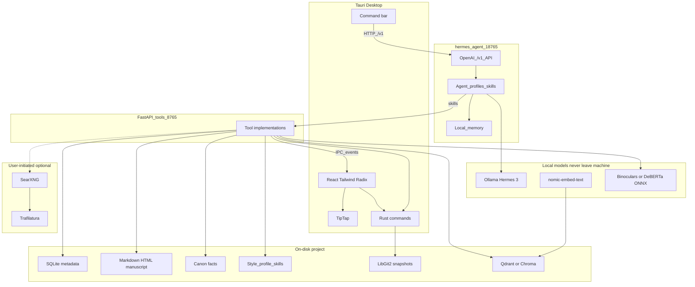

# Architecture

Purpose: describe AegisDraft’s local-first system design—process boundaries, data model, RAG, integrity, and the **hermes-agent** loop that sits above them.

Writing loop (canon, slop, briefs): [WRITING-LOOP.md](WRITING-LOOP.md).

## Golden rule

**Local by default. Anything that leaves the machine is an explicit, per-session choice that names what goes.**

The manuscript, the SQLite metadata, the vector index, the style profile, the agent traces and every snapshot live in the author's own project folder and are never transmitted. Generation, embedding, similarity, rubric scoring, plot beats and clustering all run on this machine, and all of them work with the network off.

There are exactly **two** ways anything leaves, and both are listed here rather than buried:

| Path | What goes | The gate |
| :--- | :--- | :--- |
| **A remote model** — Ollama proxies `:cloud`-tagged models to someone else's computer | The prompt, the passage being worked on, tool results, and pieces of the manuscript in context | Off by default. A per-session toggle that names the model, and the agent loop refuses a remote model outright without it. Remote models are excluded from the default model pools, so one is never picked by accident. |
| **A web similarity check** via [wigolo](https://github.com/KnockOutEZ/wigolo), run as a managed sidecar on loopback | One phrase the author ticked. Over 60 words is refused before a socket opens. Never a document, never the manuscript. | `confirmed: true` at the command and at the agent gateway, the same class of guard as `delete_document`. The word count is shown before the send; every request is appended to `research-trace.json` in the project. |

**Be precise about wigolo.** It listens on loopback, which makes it tempting to call a web check local. It is not: wigolo queries the internet on the author's behalf, so an approved phrase does leave the machine — through a component the author runs and can inspect. That is a real difference from a hosted API, and it is not the same as staying put. The confirm says so in those words.

AegisDraft starts and stops wigolo but never bundles it, and never starts it on launch — see [SIDECAR.md](SIDECAR.md) for both decisions and the orphaned-daemon bug the first live run exposed.

### Why this is stated as two paths rather than "no cloud"

An earlier version of this document said the network was "optional and user-initiated (web similarity only)" while the app already shipped remote models. A promise the code does not keep is worse than a narrower promise it does. The rule above is what the code enforces, and each gate is a test.

## System overview

**hermes-agent** orchestrates RAG and integrity by calling AegisDraft tools (via skills). It does not replace storage or the TipTap editor. The React UI reflects mutations through IPC events.

Ports and lifecycle: [HERMES-RUNTIME.md](HERMES-RUNTIME.md).

## Process boundaries

| Process | Owns |
| :--- | :--- |
| **Tauri webview (React)** | Binder, TipTap, corkboard, outliner, inspector, command bar, report UI |
| **Rust core** | File I/O, SQLite access, LibGit2 snapshots, IPC commands, process lifecycle (start/stop hermes + gateway) |
| **hermes-agent (`:18765`)** | Multi-step planning, profiles, memory, skill execution loop |
| **FastAPI tool gateway (`:8765`)** | TOOLS.md implementations, LlamaIndex retrieval helpers, Trafilatura, detectors |

UI updates are events (`binder_changed`, `highlight_range`, `report_attached`, `agent_log`). See [TOOLS.md](TOOLS.md).

## Agent loop

1. User intent (command bar, “Run Integrity Check”, scene highlight + prompt)
2. UI calls hermes-agent `/v1` with the matching **profile** (App Controller, Deep Continuity, Integrity, World-Builder)
3. hermes-agent + Hermes 3 plan steps and invoke **skills**
4. Skills HTTP to the tool gateway → mutate SQLite / Markdown / highlights / reports / style store
5. Events refresh the React UI
6. Skill policy + UI enforce **confirm** on destructive or networked tools; optional snapshot then Keep / Discard; hermes runtime caps runaway loops

Agents: [AGENTS.md](AGENTS.md). Runtime details: [HERMES-RUNTIME.md](HERMES-RUNTIME.md).

## Data model (Scrivener-style folder project)

A project is a **folder** (`.aegis` or similar analogue to `.scriv`), not a monolithic binary.

| Store | Contents |
| :--- | :--- |
| **SQLite** | Binder tree, labels, status, keywords, character/location sheets, project settings, rubric definitions |
| **Markdown / HTML files** | Scene, sheet, lore, canon, and research body text—if the app dies, authors still have readable files |
| **Canon** | Falsifiable facts (`kind: canon` under `manuscript/canon/`) plus `agent/debts.json` for propagation gaps |
| **Style / skills / memory** | Voice Part 2 profile, project-local skill manifests, hermes memory (local only) |
| **Assets** | Images, clippings, PDFs under a research/media tree |
| **Qdrant / Chroma** | Local vectors for RAG and internal similarity |
| **LibGit2 repo** | Snapshots: each “Save Snapshot” (or agent preflight) is a commit for rollback |

### Versioning

- Manual snapshot → LibGit2 commit with message
- Bulk agent writes should **optionally create a snapshot first** so authors can revert
- Per-document history can surface commits that touched that scene file

### Voice and evolution

- **Guardrails (Part 1)** are the mechanical slop rubric; not learned
- **Style profile (Part 2)** grows from accepted prose (including KEEP sentences); used for “rewrite in my voice”
- **Skills** accumulate as confirmed project packs after repeated workflows
- Neither Part 2 nor skills are uploaded; reset/edit in Settings → Voice & skills
- Layer stack, canon, briefs: [WRITING-LOOP.md](WRITING-LOOP.md)

## RAG path

1. On save / index: chunk manuscript and research text
2. Embed with `nomic-embed-text` (Ollama)
3. Upsert into local Qdrant (default) or Chroma
4. Retrieval tools (`search_binder`) return chunks with binder paths

**Deep Continuity** reasons over retrieved chunks **and `check_against_canon`** via hermes-agent multi-step skills instead of stuffing an entire book into one prompt. RAG finds similar passages; canon catches contradictory facts.

## Integrity path

Exposed as tools the Integrity profile sequences:

1. `run_slop_scan` — mechanical guardrails (no LLM); spans for highlights
2. `check_internal_similarity` — cosine similarity against the author’s own projects / drafts
3. `search_web` (opt-in) — key phrases → SearXNG → Trafilatura top results → SentenceTransformers similarity
4. `run_ai_detection` — Binoculars or DeBERTa via ONNX Runtime / vLLM, local only
5. Optional `propose_cuts` — classified fat + KEEP passage; apply only on confirm via `rewrite_range`
6. hermes-agent synthesizes a **JSON report** (scores + explanations) for charts and inline comments

Web checks never upload the full manuscript; only selected phrases leave the machine when the user confirms.

## AI detection path

- Models: Binoculars and/or fine-tuned DeBERTa-v3 (Hugging Face)
- Runtime: ONNX Runtime or local vLLM—**text stays on device**
- Output: paragraph- and document-level scores consumed by the Integrity agent

## Privacy rules (architecture)

- Default fully offline: studio, RAG, hermes-agent, detectors
- No Nous Portal / cloud tool gateway in the default profile
- Web similarity is explicit, opt-in, phrase-scoped
- Agent traces, memory, and style profile stay under project/app data
- No cloud LLM fallback in the documented architecture

Stack choices: [TECH-STACK.md](TECH-STACK.md). Product promise: [PRODUCT.md](PRODUCT.md).
