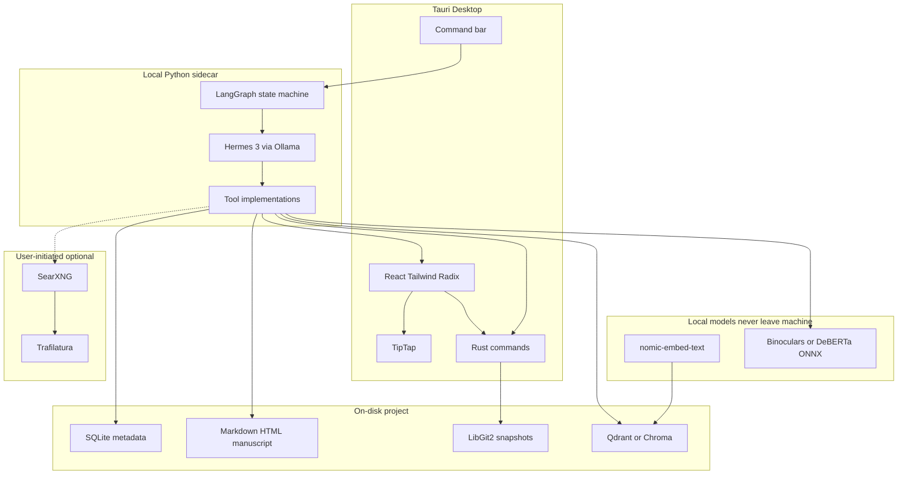

# Architecture

Purpose: describe AegisDraft’s local-first system design—process boundaries, data model, RAG, integrity, and the Hermes 3 agent loop that sits above them.

## Golden rule

Everything sensitive stays on the author’s machine: manuscript files, SQLite metadata, vector index, Ollama models, detector weights, and agent thought traces. Network is optional and user-initiated (web similarity only).

## System overview

Hermes 3 does not replace RAG or integrity. It **orchestrates** them by calling tools that mutate binder, editor, and reports. The React UI reflects those mutations.

## Process boundaries

| Process | Owns |
| :--- | :--- |
| **Tauri webview (React)** | Binder, TipTap, corkboard, outliner, inspector, command bar, report UI |
| **Rust core** | File I/O, SQLite access, LibGit2 snapshots, IPC commands, process lifecycle |
| **Python sidecar (FastAPI)** | LangGraph agents, Hermes tool loops, LlamaIndex indexing/retrieval, Trafilatura, detectors |

Default Python host: **local FastAPI** on loopback. Tauri may still own authoritative file I/O; the sidecar requests mutations through Rust commands or shared project paths. UI updates are events (`binder_changed`, `highlight_range`, `report_attached`). See [TOOLS.md](TOOLS.md).

## Agent loop

1. User intent (command bar, “Run Integrity Check”, scene highlight + prompt)
2. LangGraph graph selects the agent (App Controller, Deep Continuity, Integrity, World-Builder)
3. Hermes 3 plans steps and emits tool calls as strict JSON
4. Tools mutate SQLite / Markdown / highlights / reports
5. Events refresh the React UI
6. Graph enforces **max steps** and **human-in-the-loop** on destructive or networked tools

Agents are defined in [AGENTS.md](AGENTS.md). Tool schemas live in [TOOLS.md](TOOLS.md).

## Data model (Scrivener-style folder project)

A project is a **folder** (`.aegis` or similar analogue to `.scriv`), not a monolithic binary.

| Store | Contents |
| :--- | :--- |
| **SQLite** | Binder tree, labels, status, keywords, character/location sheets, project settings, rubric definitions |
| **Markdown / HTML files** | Scene and research body text—if the app dies, authors still have readable files |
| **Assets** | Images, clippings, PDFs under a research/media tree |
| **Qdrant / Chroma** | Local vectors for RAG and internal similarity |
| **LibGit2 repo** | Snapshots: each “Save Snapshot” (or agent preflight) is a commit for rollback |

### Versioning

- Manual snapshot → LibGit2 commit with message
- Bulk agent writes should **optionally create a snapshot first** so authors can revert
- Per-document history can surface commits that touched that scene file

## RAG path

1. On save / index: chunk manuscript and research text
2. Embed with `nomic-embed-text` (Ollama)
3. Upsert into local Qdrant (default) or Chroma
4. Retrieval tools (`search_binder`) return chunks with binder paths

**Deep Continuity** reasons over retrieved chunks (entities, timeline, locations) instead of stuffing an entire book into one prompt. Simple continue/rewrite in Phase 3 may use retrieve-and-stuff; Phase 5 agents use multi-step tool reasoning.

## Integrity path

Exposed as tools the Integrity agent sequences:

1. `check_internal_similarity` — cosine similarity against the author’s own projects / drafts
2. `search_web` (opt-in) — key phrases → SearXNG → Trafilatura top results → SentenceTransformers similarity
3. `run_ai_detection` — Binoculars or DeBERTa via ONNX Runtime / vLLM, local only
4. Hermes synthesizes a **JSON report** (scores + explanations) for charts and inline comments

Web checks never upload the full manuscript; only selected phrases leave the machine when the user confirms.

## AI detection path

- Models: Binoculars and/or fine-tuned DeBERTa-v3 (Hugging Face)
- Runtime: ONNX Runtime or local vLLM—**text stays on device**
- Output: paragraph- and document-level scores consumed by the Integrity agent

## Privacy rules (architecture)

- Default fully offline: studio, RAG, agents, detectors
- Web similarity is explicit, opt-in, phrase-scoped
- Agent traces stored under the project directory, not a remote telemetry sink
- No cloud LLM fallback in the documented architecture

Stack choices: [TECH-STACK.md](TECH-STACK.md). Product promise: [PRODUCT.md](PRODUCT.md).
