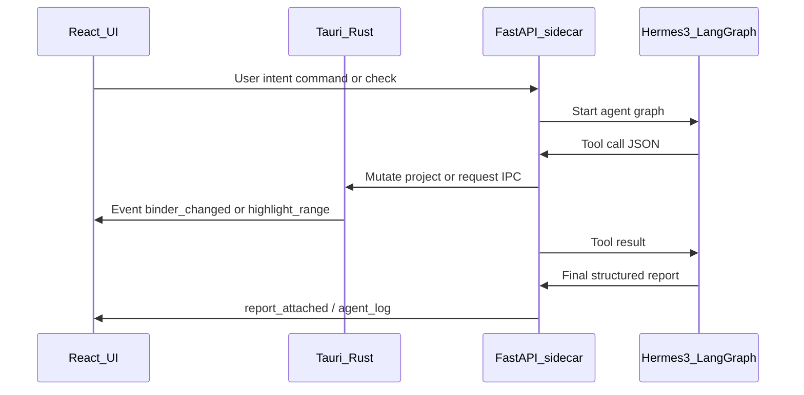

# Tools

Purpose: OpenAPI-style catalog of tools the local sidecar exposes to Hermes 3 agents, plus how the Tauri / FastAPI bridge delivers UI updates. Agents call these tools; they do not invent binder mutations in prose alone.

Agent roles: [AGENTS.md](AGENTS.md). Architecture: [ARCHITECTURE.md](ARCHITECTURE.md).

## Schema shape

Every tool is described with a name, description, and typed parameters (OpenAPI-style). Example:

```json
{
  "name": "highlight_text_in_editor",
  "description": "Highlights a specific range of text in the center editor pane.",
  "parameters": {
    "start_index": "integer",
    "end_index": "integer",
    "color": "string"
  }
}
```

Implementations live in the Python sidecar (or thin TypeScript wrappers that invoke Rust commands). Hermes emits tool calls as JSON; LangGraph executes them and feeds results back.

---

## Binder tools

| Tool | Description | Key parameters | Used by |
| :--- | :--- | :--- | :--- |
| `create_folder` | Create a binder folder/collection | `name`, `parent?` | App Controller, World-Builder |
| `create_chapter` | Create one or more empty chapter/scene docs | `parent`, `count?`, `title_prefix?` | App Controller |
| `create_character_sheet` | Create character metadata + sheet file | `name`, `parent?`, `role?` | App Controller |
| `save_to_binder` | Write content into a binder path/category | `category`, `title?`, `content`, `parent?` | World-Builder, App Controller |
| `search_binder` | Semantic / keyword search over the project index | `query`, `limit?`, `scope?` | Deep Continuity, Integrity, World-Builder |

---

## Editor tools

| Tool | Description | Key parameters | Used by |
| :--- | :--- | :--- | :--- |
| `highlight_text_in_editor` | Highlight a range in the open document | `start_index`, `end_index`, `color?` | Deep Continuity, Integrity |
| `draft_scene` | Generate prose into a scene (or return text for insert) | `context?`, `style?`, `target_doc_id?`, `length?` | World-Builder |
| `replace_range` | Replace a text span in the editor | `start_index`, `end_index`, `text` | App Controller, Continuity (fixes) |

---

## Continuity tools

| Tool | Description | Key parameters | Used by |
| :--- | :--- | :--- | :--- |
| `extract_entities` | Extract characters, times, locations, objects from text | `text` | Deep Continuity |

---

## Integrity tools

| Tool | Description | Key parameters | Used by |
| :--- | :--- | :--- | :--- |
| `check_internal_similarity` | Compare text to local vectors (self-plagiarism / prior drafts) | `text`, `threshold?`, `scope?` | Integrity |
| `search_web` | Opt-in web phrase search via SearXNG + Trafilatura | `queries` (string[]), `top_k?` | Integrity |
| `run_ai_detection` | Local Binoculars / DeBERTa scores | `text` | Integrity |

`search_web` requires user confirmation (human-in-the-loop). It must not upload the full manuscript—only provided query phrases / short excerpts.

---

## Lore tools

| Tool | Description | Key parameters | Used by |
| :--- | :--- | :--- | :--- |
| `generate_lore` | Generate world-building notes for a prompt | `prompt`, `tone?`, `length?` | World-Builder |

---

## Agent ↔ tool matrix

| Agent | Primary tools |
| :--- | :--- |
| App Controller | `create_folder`, `create_chapter`, `create_character_sheet`, `save_to_binder`, `replace_range` |
| Deep Continuity | `extract_entities`, `search_binder`, `highlight_text_in_editor` |
| Integrity | `check_internal_similarity`, `search_web`, `run_ai_detection`, `highlight_text_in_editor` |
| World-Builder | `generate_lore`, `save_to_binder`, `draft_scene`, optionally `create_folder` / `create_chapter` |

---

## Bridge



### Rules

- **Python sidecar** hosts LangGraph, LlamaIndex helpers, Trafilatura, and detectors
- **Tauri IPC** and/or **loopback FastAPI** connect sidecar ↔ app
- **Rust** remains authoritative for file I/O and LibGit2 snapshots when possible
- **UI updates are events**, not “please refresh”: `binder_changed`, `highlight_range`, `report_attached`, `agent_log`
- Agents mutate **project files and metadata**; React reflects them—chat is a transcript of tool results

### Guardrail hooks

Tools that delete documents, compile manuscripts, or call `search_web` must support interrupt / confirm before execution (see [AGENTS.md](AGENTS.md) guardrails).

Phase wiring checklist: [phases/05-hermes-agents.md](phases/05-hermes-agents.md).
