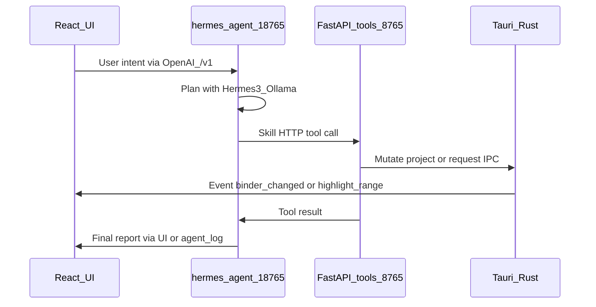

# Tools

Purpose: OpenAPI-style catalog of tools the FastAPI tool gateway exposes; **hermes-agent skills** call these endpoints. Agents do not invent binder mutations in prose alone.

Agent roles: [AGENTS.md](AGENTS.md). Runtime: [HERMES-RUNTIME.md](HERMES-RUNTIME.md). Architecture: [ARCHITECTURE.md](ARCHITECTURE.md). Writing loop (canon, slop, briefs): [WRITING-LOOP.md](WRITING-LOOP.md).

## Schema shape

Every tool is described with a name, description, and typed parameters (OpenAPI-style). Example:

```json
{
  "name": "highlight_text_in_editor",
  "description": "Highlights a specific range of text in the center editor pane.",
  "parameters": {
    "start_index": "integer",
    "end_index": "integer",
    "color": "string"
  }
}
```

Implementations live on the **tool gateway** (`127.0.0.1:8765`) and/or thin TypeScript wrappers that invoke Rust commands. hermes-agent skills HTTP-call the gateway; results feed back into the hermes tool loop.

Revision briefs, canon entries, slop scans, and the drafting context pack: [WRITING-LOOP.md](WRITING-LOOP.md). `draft_scene` / `rewrite_range` `brief` object:

```json
{
  "kind": "tighten",
  "problem": "string",
  "keep": ["exact sentences that must survive"],
  "change": [{ "action": "cut", "quote": "…", "instruction": "…" }],
  "voice_rules": ["string"],
  "target_word_count": 2800
}
```

---

## Binder tools

| Tool | Description | Key parameters | Used by |
| :--- | :--- | :--- | :--- |
| `create_folder` | Create a binder folder/collection | `name`, `parent?` | App Controller, World-Builder |
| `create_chapter` | Create one or more empty chapter/scene docs | `parent`, `count?`, `title_prefix?` | App Controller |
| `create_character_sheet` | Create character metadata + sheet file | `name`, `parent?`, `role?` | App Controller |
| `save_to_binder` | Write content into a binder path/category | `category`, `title?`, `content`, `parent?`, `kind?` (`lore` \| `sheet` \| `canon` \| `scene` \| `research`) | World-Builder, App Controller |
| `search_binder` | Semantic / keyword search over the project index | `query`, `limit?`, `scope?` | Deep Continuity, Integrity, World-Builder |
| `append_canon_entry` | Add a falsifiable fact to the Canon folder | `statement`, `source_doc_id`, `category?`, `source_span?` | Deep Continuity, World-Builder |
| `check_against_canon` | Compare text to canon; return contradictions | `text`, `doc_id?` | Deep Continuity |
| `log_propagation_debt` | Record a lore/continuity gap without inventing a fix | `trigger`, `affected_doc_ids[]`, `status?: pending` | Deep Continuity, World-Builder |

---

## Editor tools

| Tool | Description | Key parameters | Used by |
| :--- | :--- | :--- | :--- |
| `highlight_text_in_editor` | Highlight a range in the open document | `start_index`, `end_index`, `color?` | Deep Continuity, Integrity |
| `draft_scene` | Generate prose into a scene (or return text for insert). Loads the [context pack](WRITING-LOOP.md#drafting-context-pack). Replacing more than a sentence requires a [revision brief](WRITING-LOOP.md#revision-brief). | `target_doc_id?`, `brief?` (keep / change / voice_rules / kind / target_word_count), `context?`, `style?`, `length?` | World-Builder |
| `replace_range` | Replace a text span in the editor | `start_index`, `end_index`, `text` | App Controller, Continuity (fixes) |
| `rewrite_range` | Rewrite a span or whole scene from a revision brief; must preserve `brief.keep` | `target_doc_id`, `start_index?`, `end_index?`, `brief` | World-Builder, Integrity (apply cuts) |

---

## Continuity tools

| Tool | Description | Key parameters | Used by |
| :--- | :--- | :--- | :--- |
| `extract_entities` | Extract characters, times, locations, objects from text | `text` | Deep Continuity |
| `check_foreshadowing_ledger` | List plants without payoffs (and payoffs without plants) from outline metadata | `scope?` | Deep Continuity |

---

## Integrity tools

| Tool | Description | Key parameters | Used by |
| :--- | :--- | :--- | :--- |
| `check_internal_similarity` | Compare text to local vectors (self-plagiarism / prior drafts) | `text`, `threshold?`, `scope?` | Integrity |
| `search_web` | Opt-in web phrase search via SearXNG + Trafilatura | `queries` (string[]), `top_k?` | Integrity |
| `run_ai_detection` | Local Binoculars / DeBERTa scores | `text` | Integrity |
| `run_slop_scan` | Mechanical anti-slop rubric (no LLM): banned words, fiction tells, telling, rhythm | `text`, `doc_id?` | Integrity |
| `propose_cuts` | Local judge: classified FAT / REDUNDANT / OVER-EXPLAIN / … quotes plus `tightest_passage` | `text`, `doc_id?`, `target_cut_words?` | Integrity |

`search_web` requires user confirmation (human-in-the-loop). It must not upload the full manuscript—only provided query phrases / short excerpts.

`propose_cuts` and applying `rewrite_range` from those cuts require confirm. Never auto-apply. JSON shapes: [WRITING-LOOP.md](WRITING-LOOP.md).

---

## Lore tools

| Tool | Description | Key parameters | Used by |
| :--- | :--- | :--- | :--- |
| `generate_lore` | Generate world-building notes for a prompt | `prompt`, `tone?`, `length?` | World-Builder |

---

## Agent ↔ tool matrix

| Agent | Primary tools |
| :--- | :--- |
| App Controller | `create_folder`, `create_chapter`, `create_character_sheet`, `save_to_binder`, `replace_range` |
| Deep Continuity | `extract_entities`, `search_binder`, `check_against_canon`, `append_canon_entry`, `check_foreshadowing_ledger`, `log_propagation_debt`, `highlight_text_in_editor` |
| Integrity | `check_internal_similarity`, `search_web`, `run_ai_detection`, `run_slop_scan`, `propose_cuts`, `highlight_text_in_editor` |
| World-Builder | `generate_lore`, `save_to_binder`, `draft_scene`, `rewrite_range`, optionally `create_folder` / `create_chapter` / `append_canon_entry` |

---

## Bridge



### Rules

- **hermes-agent** (`:18765`) owns the LLM/tool loop, memory, and skills
- **FastAPI tool gateway** (`:8765`) hosts TOOLS.md implementations, LlamaIndex helpers, Trafilatura, detectors
- **Tauri IPC** connects gateway ↔ app UI events
- **Rust** remains authoritative for file I/O and LibGit2 snapshots when possible
- **UI updates are events**, not “please refresh”: `binder_changed`, `highlight_range`, `report_attached`, `agent_log`
- Agents mutate **project files and metadata**; React reflects them—chat is a transcript of tool results

### Guardrail hooks

Tools that delete documents, compile manuscripts, or call `search_web` must support interrupt / confirm before execution (see [AGENTS.md](AGENTS.md) guardrails).

Phase wiring checklist: [phases/05-hermes-agents.md](phases/05-hermes-agents.md). Runtime: [HERMES-RUNTIME.md](HERMES-RUNTIME.md).

---

## v2 tools

Appended for Phases 6–9. Same schema shape as above (`name`, `description`, `parameters`). Does not replace the Phase 1–5 catalog.

### Collections and Scrivenings (Phase 6)

| Tool | Description | Key parameters |
| :--- | :--- | :--- |
| `create_collection` | Create a manual or empty collection | `name`, `doc_ids?`, `kind?: manual` |
| `query_smart_collection` | Create/refresh a smart collection from metadata filters | `name`, `filters` (status, label, keyword, pov, section_type) |
| `open_scrivenings` | Open continuous edit view over child docs | `parent_id` or `doc_ids[]` |
| `bulk_set_metadata` | Batch-set fields on multi-select | `doc_ids[]`, `status?`, `labels?`, `keywords?`, `section_type?` |

### Compile (Phase 7)

| Tool | Description | Key parameters |
| :--- | :--- | :--- |
| `compile_manuscript` | Assemble and export manuscript | `preset`, `filters?`, `root?: binder_id \| collection_id`, `format?: docx \| pdf \| epub \| markdown \| fountain` |

Requires human-in-the-loop confirm before overwrite (same guardrail class as delete / web search).

### Visualization core (Phase 8)

| Tool | Description | Key parameters |
| :--- | :--- | :--- |
| `generate_plot_diagram` | Classify synopses into story beats | `method`: three_act \| freytag \| heros_journey |
| `build_character_graph` | Relationship graph from sheets + co-occurrence | `filters?` (act_range, labels) |
| `generate_timeline` | Narrative vs chronological scene order | `mode`: chronological \| narrative |
| `canvas_to_binder` | Commit infinite-canvas layout to binder/collection | `canvas_state` |

### Visualization advanced (Phase 9)

| Tool | Description | Key parameters |
| :--- | :--- | :--- |
| `generate_mind_map` | Theme/plot/character mind map | `query`, `root?` |
| `generate_flowchart` | Branching or chronological flowchart | `type`, `scene_ids?` |
| `generate_infographic` | Story-bible diagram | `type`: family_tree \| magic_system \| location_map |
| `suggest_clusters` | Propose collections from semantic similarity | `threshold` |

Phase docs: [06](phases/06-scrivener-completeness.md), [07](phases/07-compile-export.md), [08](phases/08-ai-story-visualization.md), [09](phases/09-ai-viz-advanced.md).
