# AegisDraft — step-by-step demo

A 12-minute live demo. Every step below was performed on the real macOS build
before this was written, and each screenshot is the result of the step above it.

**The one line to open with:** *everything you are about to see runs on this
laptop. There is no account, no upload, and I can turn off the wifi.*

---

## Before the room arrives (10 minutes)

**1. Have a local model.** Ollama running, with one generation model and the
embedding model:

```bash
ollama pull qwen3:8b && ollama pull nomic-embed-text
```

**2. Build the app once.**

```bash
npm install && npm run app:build -- --bundles app
```

**3. Seed the demo project.** The repo ships a seeder, so the demo always starts
from the same book — including a deliberately duplicated paragraph for the
integrity step and out-of-order story dates for the timeline.

```bash
cd src-tauri && cargo run --example seed_project -- "$HOME/Documents/AegisDraft Demo" "The Salt Road"
```

**4. Launch straight into it.**

```bash
AEGISDRAFT_OPEN="$HOME/Documents/AegisDraft Demo/The Salt Road.aegis" open src-tauri/target/release/bundle/macos/AegisDraft.app
```

**5. Open a Finder window** on `~/Documents/AegisDraft Demo/The Salt Road.aegis`
and leave it behind the app. You will switch to it twice, and it does more work
than any slide.

> **Reset between demos:** `rm -rf "$HOME/Documents/AegisDraft Demo"` and re-run
> step 3. Ten seconds.

---

## Step 1 — The promise, before the product (30 s)

Start on the launch screen.

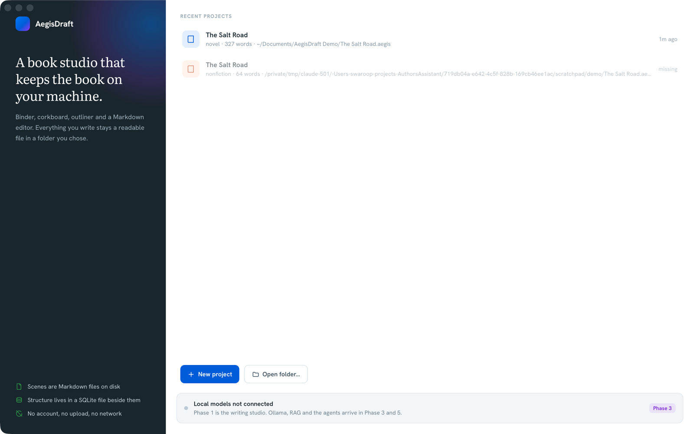

> "Recent projects, real paths, word counts. Bottom left is the whole pitch:
> scenes are Markdown files on disk, structure is a SQLite file beside them, no
> account, no upload, no network."

Click **The Salt Road**.

---

## Step 2 — It is a writing tool first (60 s)

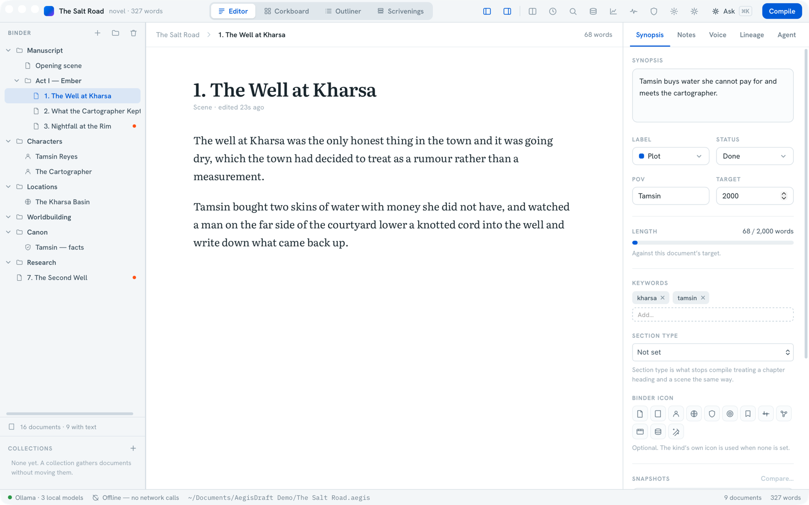

> "Binder, editor, inspector. If you have used Scrivener this is home."

Do three things, quickly:

1. Type a sentence into the scene. Point at the dirty dot, then the status bar —
   it saves 800 ms after you stop.
2. Double-click a binder title and rename it.
3. **Switch to Finder.** The file was renamed on disk too, and the sentence you
   just typed is in it.

> "That is the contract. The app is a view over a folder, not a container."

---

## Step 3 — Four views of one book (45 s)

Click Corkboard, then Outliner, then Scrivenings, pausing a beat on each.

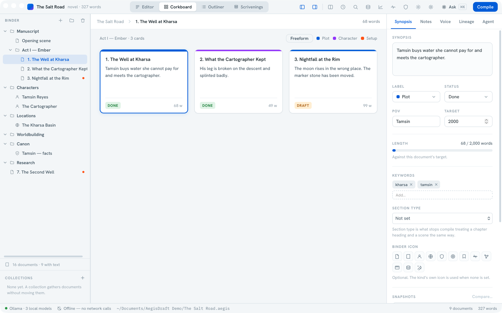
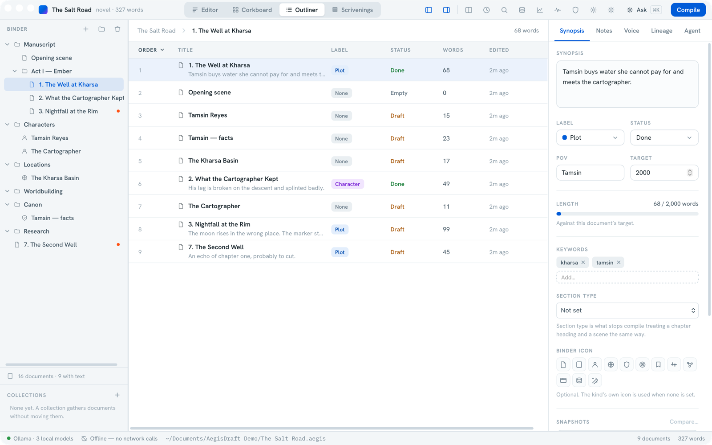
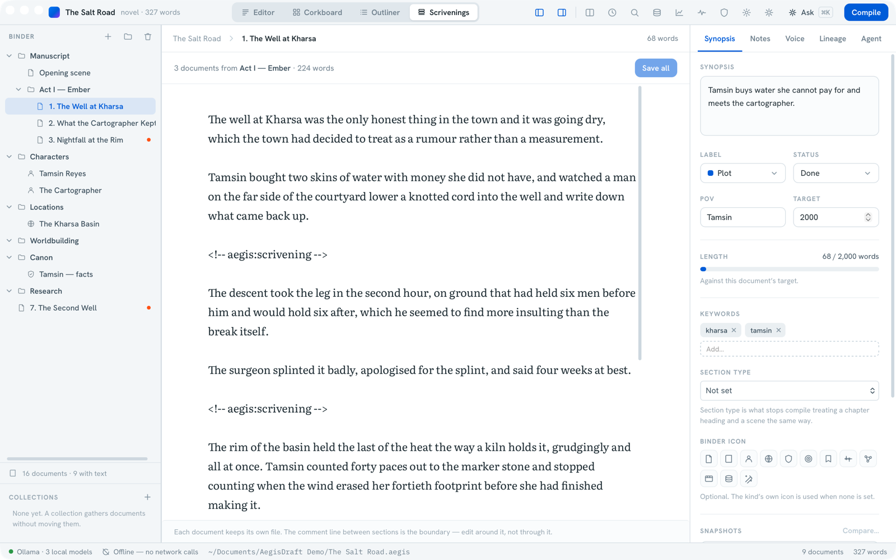

> "Same documents, four readings. Scrivenings is the one people miss — it
> stitches the selection into one editable text and writes your edits back to
> the right files."

---

## Step 4 — Ask the book a question (90 s)

Click the magnifier, then **Index now**.

> "It is embedding the whole project with a model on this machine. Eight
> documents, about a second."

Type, verbatim:

```
who was injured, and how was it treated?
```

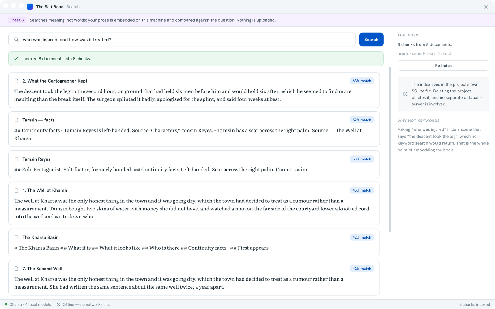

> "Top hit, 63%: *the descent took the leg.* The scene contains none of my
> words — no 'injured', no 'treated'. That is the difference between searching a
> book and searching for a string. And the index lives inside the project's own
> SQLite file, so there is no server to run and nothing to delete separately."

---

## Step 5 — A model that helps and changes nothing (90 s)

Open **Assist**.

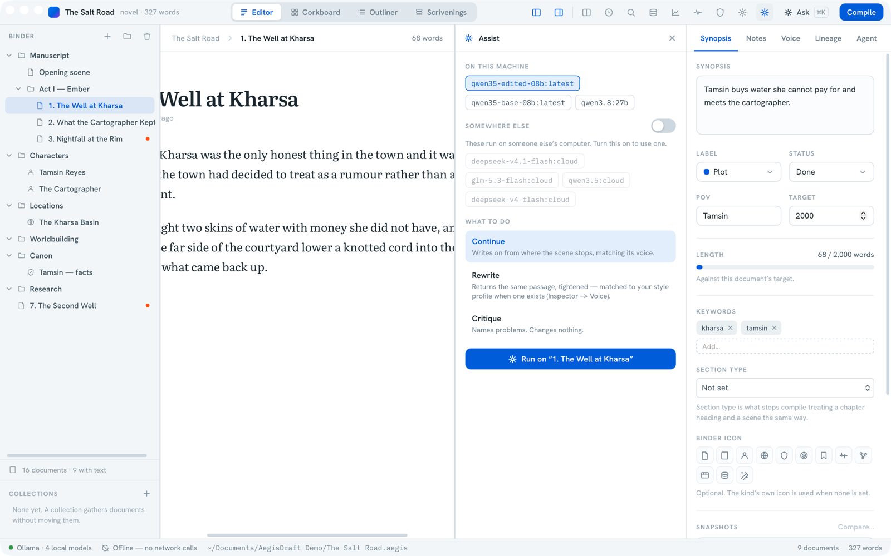

> "Models on this machine, one click. Below them, 'Somewhere else' — the cloud
> tags. Off by default, and when it is on the run button reads *Send to
> qwen3.5:cloud* by name. You cannot reach one by accident; the refusal is
> enforced below the UI, not in the button."

Choose **Critique** and run it.

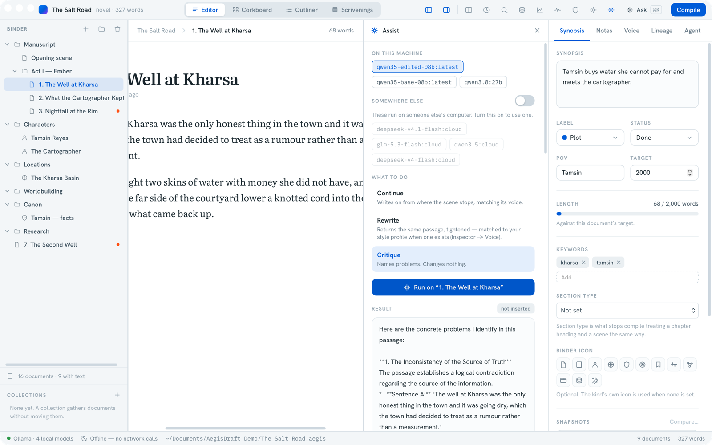

> "It names problems and changes nothing. And look at the badge: **not
> inserted**. Nothing a model writes enters the manuscript without a person."

---

## Step 6 — The agent does the work (2 min) — *the centrepiece*

Press **⌘K**.

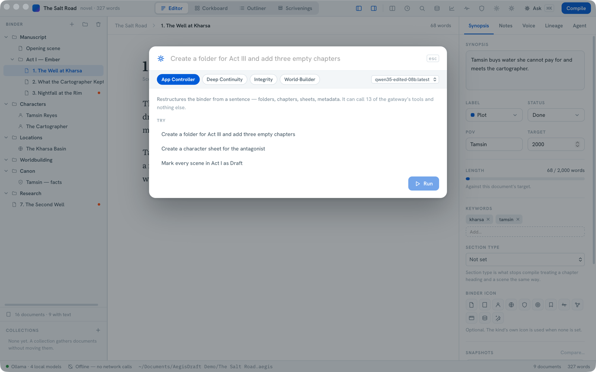

> "Four profiles. A profile is a system prompt **plus a tool subset** — the
> World-Builder is not given `delete_document`, so it cannot delete however
> cleverly you prompt it. That is a capability boundary, not a please."

Pick the suggestion *"Create a folder for Act III and add three empty chapters"*
and hit **Run**. **Watch the binder, not the dialog.**

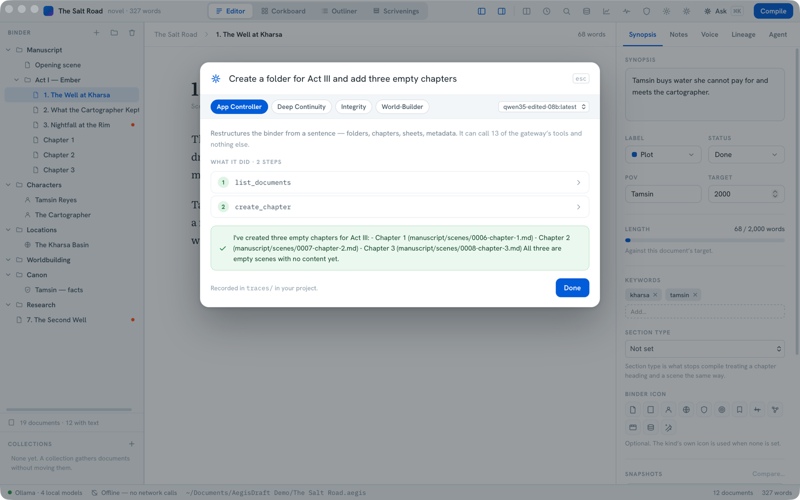

> "Two steps: it listed the documents, then created the chapters. They appeared
> in the binder while we were talking — sixteen documents to nineteen. There
> are three new Markdown files in that Finder window. This is not a chatbot
> telling me which menu to click."

Point at the footer: *Recorded in `traces/` in your project.*

### Now the important half

Press **⌘K** again and type:

```
Delete the scene called Opening scene
```

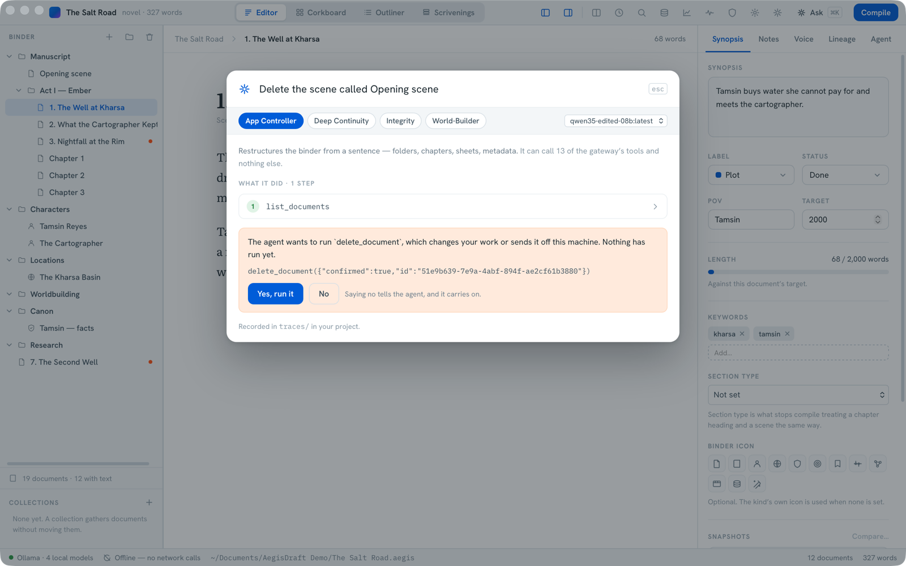

> "It stopped. `delete_document` is guarded, so the run **pauses with nothing
> executed** and shows me the exact call — arguments and all."

Click **No**.

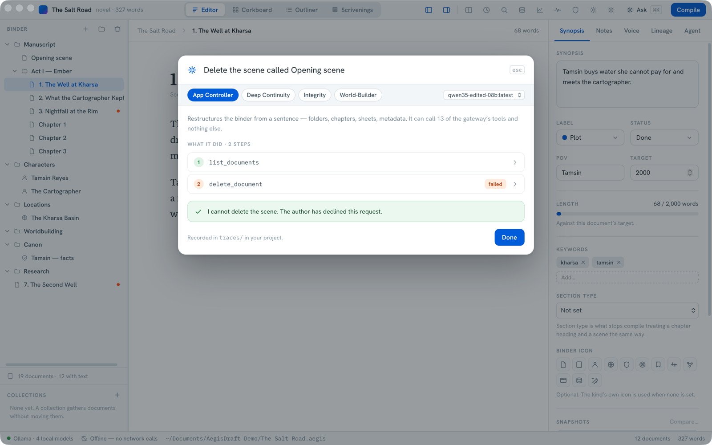

> "The step is marked failed, the refusal goes back to the model, and it says so
> in plain words. Let me prove it."

**Switch to Finder.** `0001-opening-scene.md` is still there.

---

## Step 7 — Integrity, and the number we refuse to make up (2 min)

Click the shield.

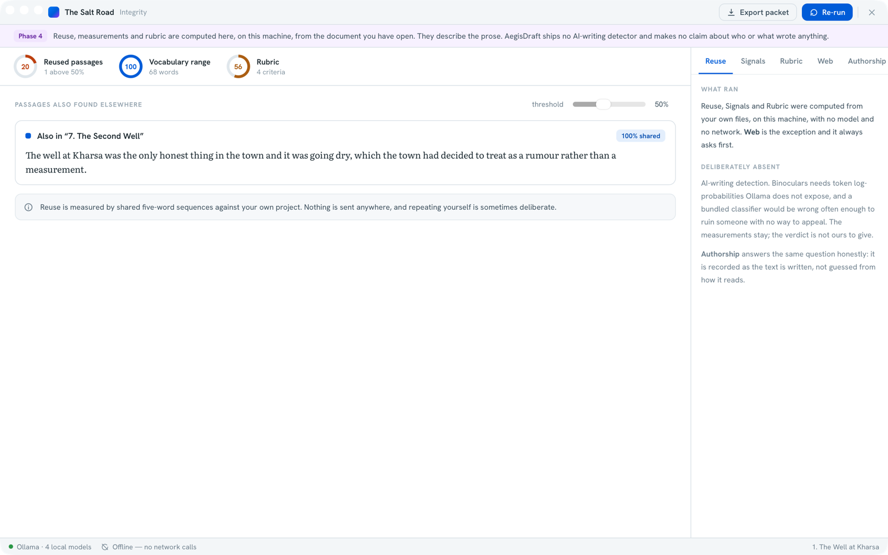

> "Reuse, by shared five-word sequences, against my own project. It found a
> paragraph I duplicated between chapter one and chapter seven, at 100%. No
> model ran. Nothing was sent anywhere."

Click through **Signals** and **Rubric**, then stop on **Authorship**.

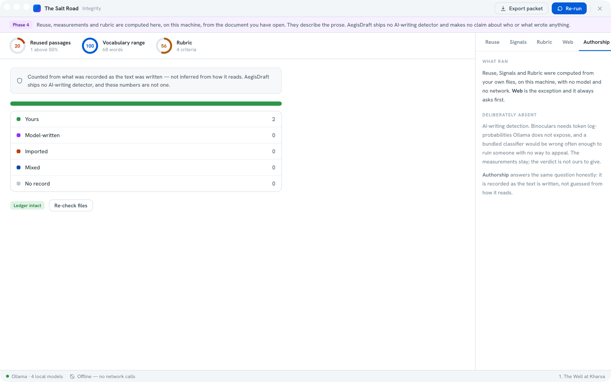

> "Here is where we differ from everyone selling AI detection. We ship no
> detector. Binoculars needs token log-probabilities Ollama does not expose, and
> a bundled classifier is wrong often enough to ruin a student who has no way to
> appeal.
>
> So we answer the same question honestly. Two paragraphs, both mine, zero
> model-written — **counted from what was recorded as the text was written**, not
> guessed from how it reads. Where there is no record, it says *no record*."

Then the inspector's **Lineage** tab:

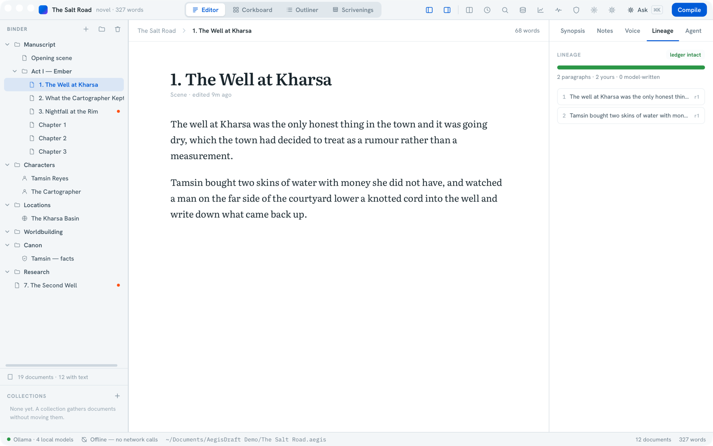

> "Per paragraph, with a stable id that survives rewriting and reordering, in a
> hash-chained ledger inside the project. *Ledger intact.* It is tamper-evident,
> not tamper-proof — it tells you something changed, not who. We say that in the
> UI, because a promise the code does not keep is worse than a narrow one it does."

---

## Step 8 — It knows the shape of the book (60 s)

Click Story, then **Continuity**.

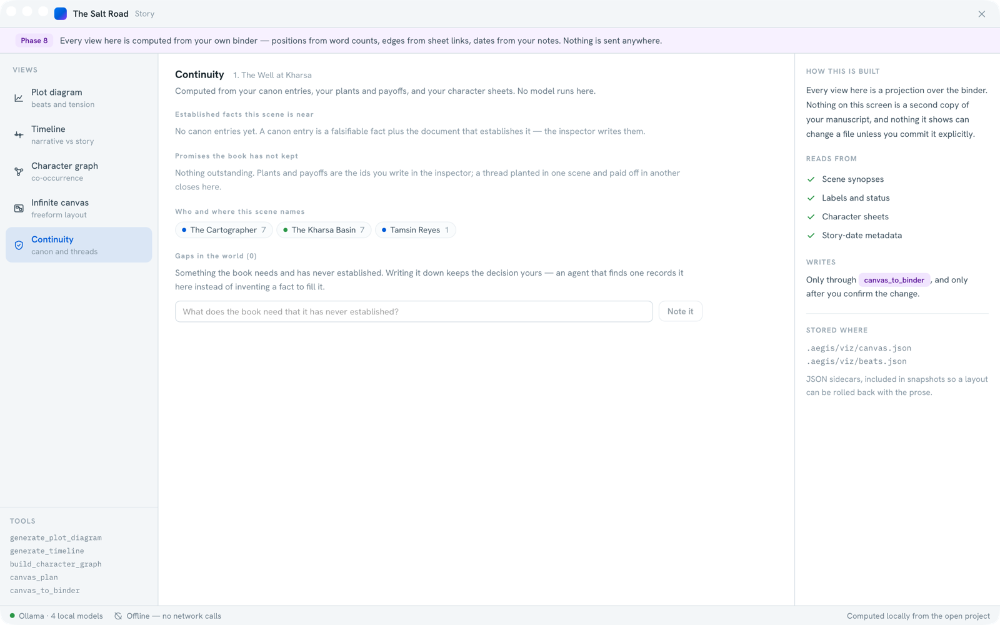

> "Established facts this scene stands near, promises the book has not kept, who
> and where it names. No model runs here — it is arithmetic over fields I already
> filled in. And *gaps in the world*: when the book needs a fact it has never
> established, you write the gap down. A model that answers 'what colour are the
> guild robes' by choosing one has quietly become the author of your world."

Click **Insights** for the pacing curve.

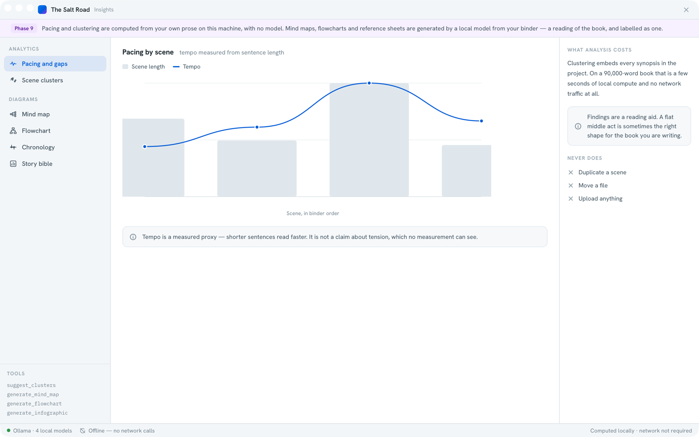

> "Measured from sentence length, and labelled as a proxy — 'it is not a claim
> about tension, which no measurement can see.' The right-hand column tells you
> what it never does: duplicate a scene, move a file, upload anything."

---

## Step 9 — It comes out as a book (45 s)

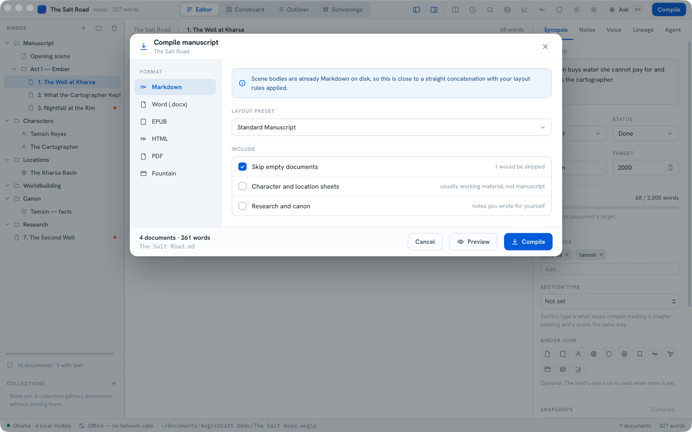

> "Markdown, Word, EPUB, HTML, PDF, Fountain, with layout presets. Four
> documents, 261 words — it counts exactly what it will write before it writes
> it."

Compile to Markdown and open the file.

---

## Step 10 — Close the loop (30 s)

Open **Settings → Privacy**.

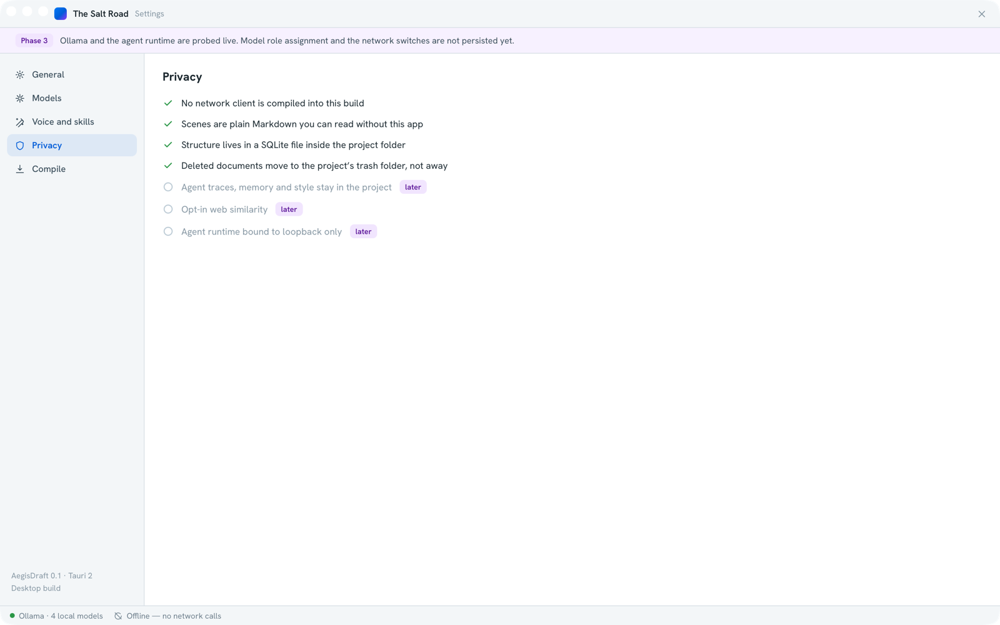

> "Not a marketing page. A list of what this build enforces, with the items that
> are not enforced yet greyed out and marked *later*. That is the whole
> company's posture in one screen."

**Turn off the wifi and do step 4 and step 5 again.** It is twenty seconds and
it is the thing people remember.

---

## If a step fails

| Symptom | Cause | Say this |
| :--- | :--- | :--- |
| Assist / Ask list no models | Ollama not running | start Ollama, re-open the panel; it probes live |
| Search offers nothing to index | no `nomic-embed-text` | pull it, Re-index |
| Agent returns prose and no steps | the small model missed the tool call | switch the model picker to the larger local model and re-run |
| Web tab in Integrity is unavailable | wigolo not started | Settings → Models → **Start**, or skip it — everything else is offline anyway |
| Nothing in Research | no source registered | **Add source** takes Markdown, text, HTML and DOCX; PDFs need `pdftotext` |

Running the demo on a small local model is a feature, not a risk: if a 1.8 GB
model on a laptop can drive the binder, the claim that this does not need a data
centre is already proved.

---

## The three sentences to land

1. Your unpublished manuscript never leaves your machine, and we can show you
   the folder.
2. The assistant does the work in the project — it creates, edits, reports —
   and it stops and asks before anything it cannot undo.
3. We answer "who wrote this" from a record kept as you write, not from a
   detector guessing at your prose.
