# AegisDraft — User guide

A book studio that keeps the book on your machine. This guide walks every screen
of the shipping desktop app, in the order you will meet them.

Every screenshot here was taken from the real macOS build (`npm run app:build`)
driving a real project on disk — `~/Documents/AegisDraft Demo/The Salt Road.aegis`
— with Ollama running locally. Nothing is a mock-up.

---

## 1. Install and run

```bash
npm install
```

```bash
npm run app
```

`npm run app` builds the Rust core and opens the desktop app. For a browser-only
preview of the interface with a sample project and no Rust toolchain:

```bash
npm run dev
```

To build a distributable `.app`:

```bash
npm run app:build -- --bundles app
```

### What you need

| Thing | Needed for | Without it |
| :--- | :--- | :--- |
| Rust toolchain | the desktop app | use `npm run dev` for the UI only |
| [Ollama](https://ollama.com) | Assist, Search, agents, diagrams | everything else still works |
| a generation model, e.g. `ollama pull qwen3:8b` | Continue / Rewrite / Critique, agents | those actions are unavailable |
| `nomic-embed-text` | semantic Search, clustering | Search offers to build nothing |
| `pdftotext` | PDF sources in Research | other formats still ingest |

AegisDraft never asks for an account, a key or a sign-in. There is nowhere to put one.

---

## 2. The launch screen

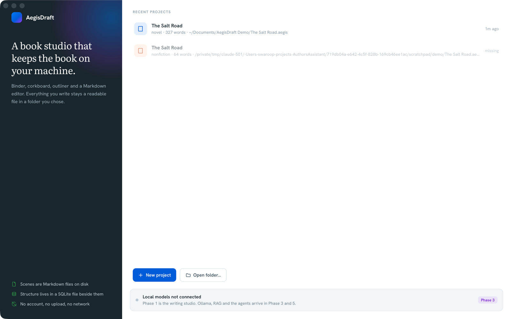

Recent projects, with word count and the real path. A project that has moved is
marked **missing** rather than quietly vanishing.

- **New project…** asks where the project should live, then creates
  `<name>.aegis` there.
- **Open folder…** opens an existing `.aegis` folder.

The three lines at the bottom left are the product's promise, and the Privacy
screen (§10) is where you can check them.

### What a project is on disk

A project is a folder, not a database blob:

```
The Salt Road.aegis/
  project.sqlite              structure and metadata only — never prose
  manuscript/
    scenes/0002-1-the-well-at-kharsa.md
    characters/0001-tamsin-reyes.md
    locations/   worldbuilding/   canon/
  research/
  traces/                     one JSON file per agent run
  assets/   trash/
```

Files are named `<counter>-<slug>.md`, so the folder reads in creation order in
Finder. If AegisDraft disappeared tomorrow, the book is still there and still
readable in any text editor.

---

## 3. The studio

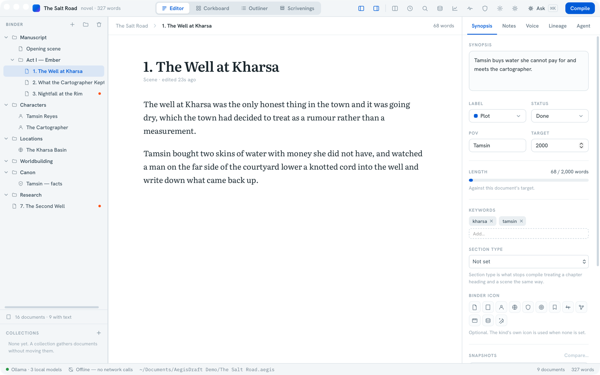

Three panes, all bound to the same documents.

**Binder (left).** The whole project tree. Create with `+`, make a folder with
the folder button, delete to the project's `trash/` with the bin. Double-click a
title to rename — the file on disk is renamed to match. Drag to reorder or nest.
Below it, **Collections** gather documents without moving them.

**Editor (centre).** TipTap over Markdown. It autosaves 800 ms after you stop
typing, on ⌘S, when you switch documents, and when the window loses focus.
Writes are atomic: a crash mid-save leaves the old file or the new one, never a
half-written one.

**Inspector (right).** Five tabs:

| Tab | What it holds |
| :--- | :--- |
| Synopsis | synopsis, label, status, POV, target, length bar, keywords, section type, binder icon, snapshots |
| Notes | your own notes on the document, plus plants and payoffs |
| Voice | the style profile measured from the prose you marked Done |
| Lineage | who wrote each paragraph (§8) |
| Agent | the trace of agent runs touching this document |

**Section type** is what stops Compile treating a chapter heading and a scene
the same way.

### Title-bar controls

Left to right after the view switcher: show/hide binder (⌘B), show/hide
inspector (⌘I), open the selected document beside the editor, snapshot, Search,
Research, Story, Insights, Integrity, Settings, Assist, **Ask ⌘K**, **Compile**.

---

## 4. Four views of the same book

**Corkboard** — index cards carrying the synopsis, status and word count. Colour
is the label. **Freeform** lets you drag cards anywhere and keeps the layout.

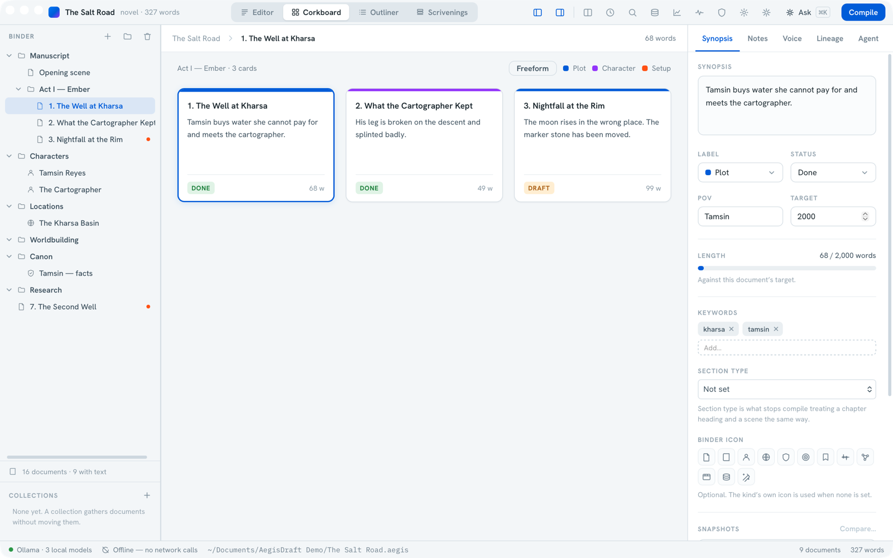

**Outliner** — a sortable table of title, synopsis, label, status, words and
last edit. Click a column header to sort.

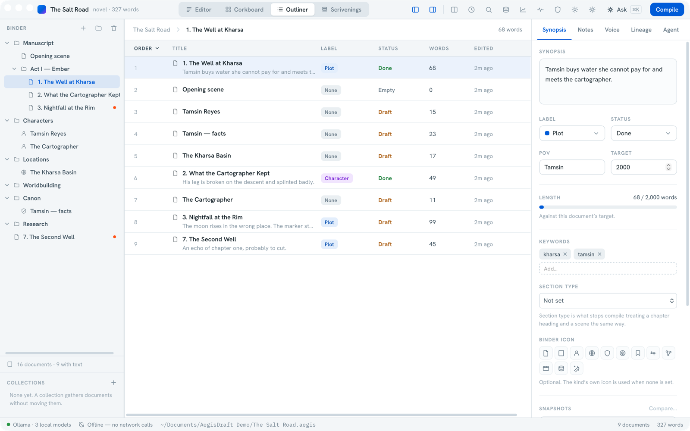

**Scrivenings** — the selected documents stitched into one continuous editable
text, with the boundaries marked. Edits are written back to the right file.

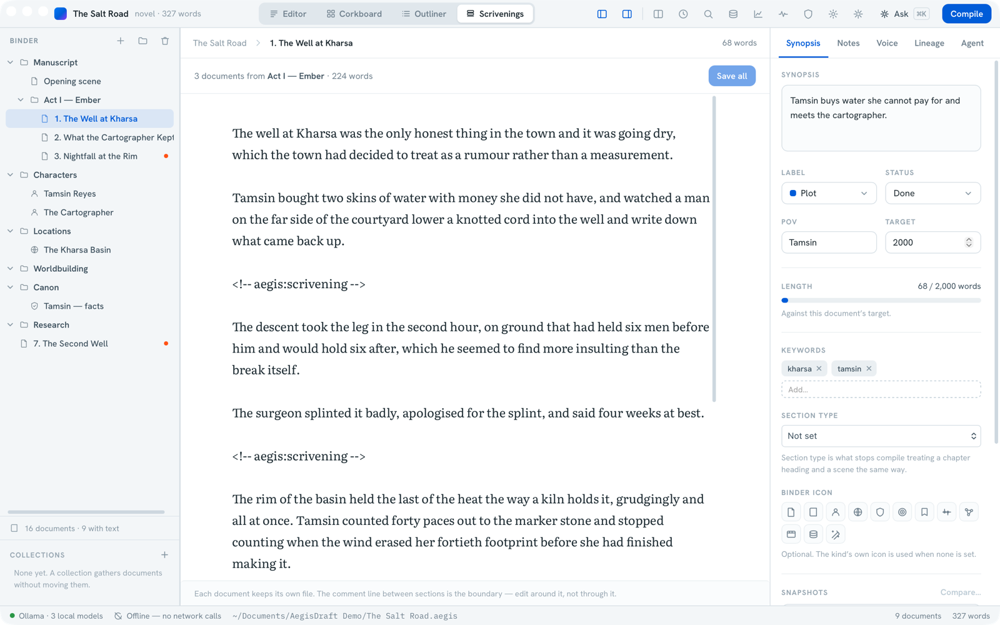

---

## 5. Assist — a local model, on this document

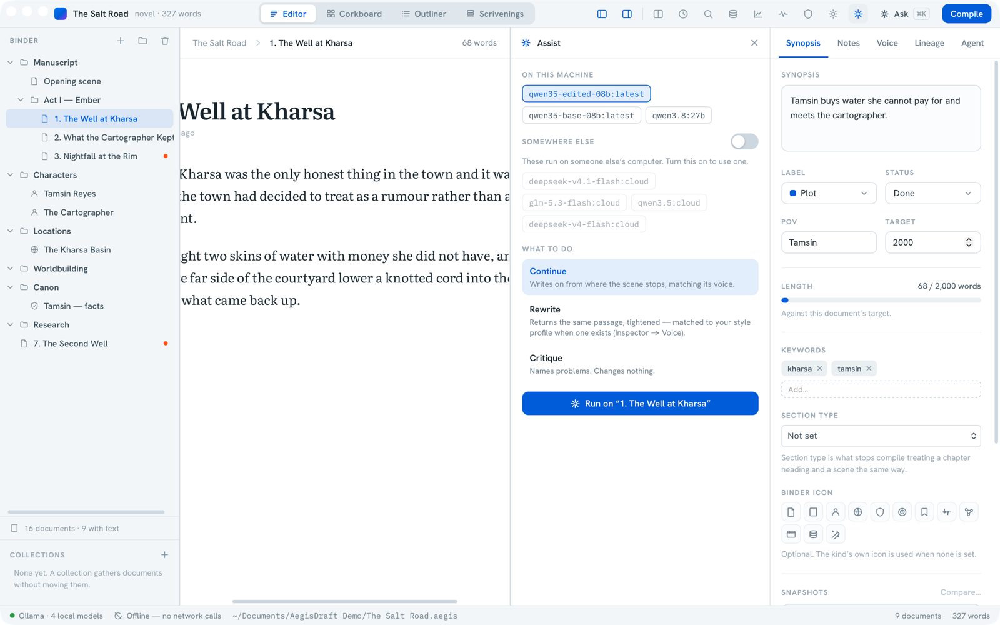

**On this machine** lists the generation models Ollama has locally; one click
selects. **Somewhere else** lists cloud-proxied tags behind an off-by-default
switch — those run on someone else's computer, and the run button says so by
name before anything is sent.

Three actions:

- **Continue** — writes on from where the scene stops, matching its voice.
- **Rewrite** — returns the same passage, tightened, matched to your style
  profile when one exists.
- **Critique** — names problems and changes nothing.

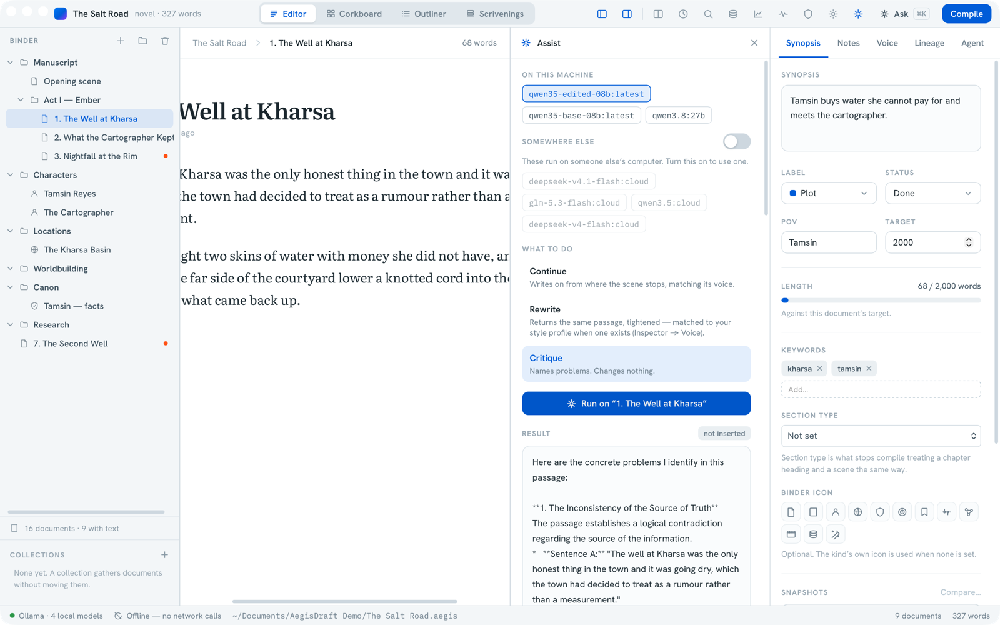

The result is marked **not inserted** until you put it in. Nothing an assistant
writes lands in your manuscript without you.

---

## 6. Search — ask the book a question

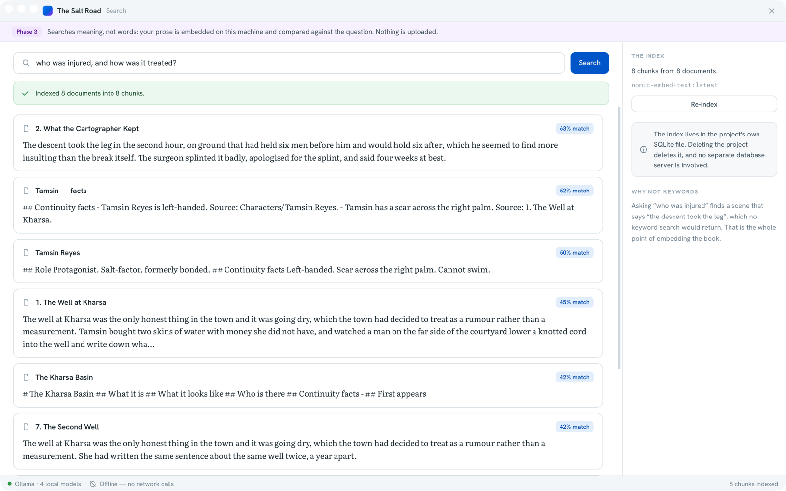

Press the magnifier. The first time, **Index now** embeds every document locally
with `nomic-embed-text`; the index lives in the project's own SQLite file, so
deleting the project deletes it too — there is no separate database server.

Searching is by meaning, not keyword. In the screenshot, *"who was injured, and
how was it treated?"* returns the scene that says *"the descent took the leg"* at
63% — a scene containing none of the query's words.

---

## 7. Integrity

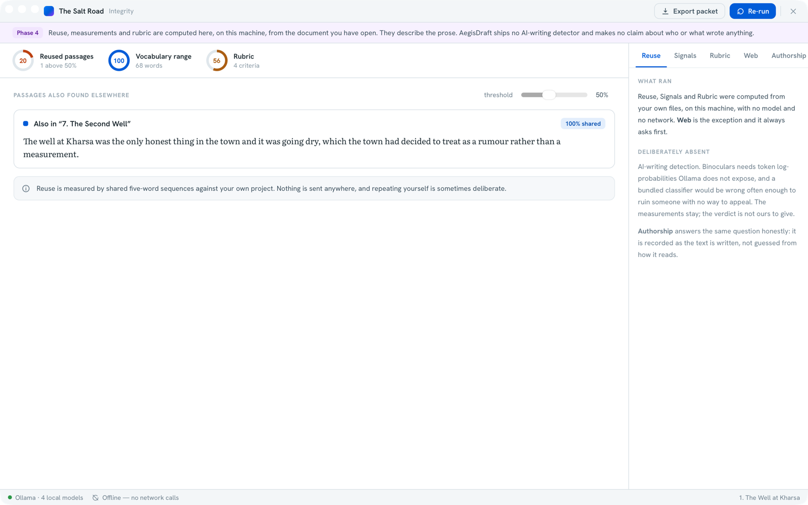

Reuse, Signals and Rubric are computed from your own files, on your machine,
with no model and no network. **Web** is the only exception and always asks
first.

- **Reuse** — shared five-word sequences against the rest of your own project.
  Here it catches a paragraph duplicated between chapter 1 and "The Second Well"
  at 100%. The threshold slider is yours to set.
- **Signals** — measurements of the prose: vocabulary range, sentence rhythm,
  the mechanical tells.

  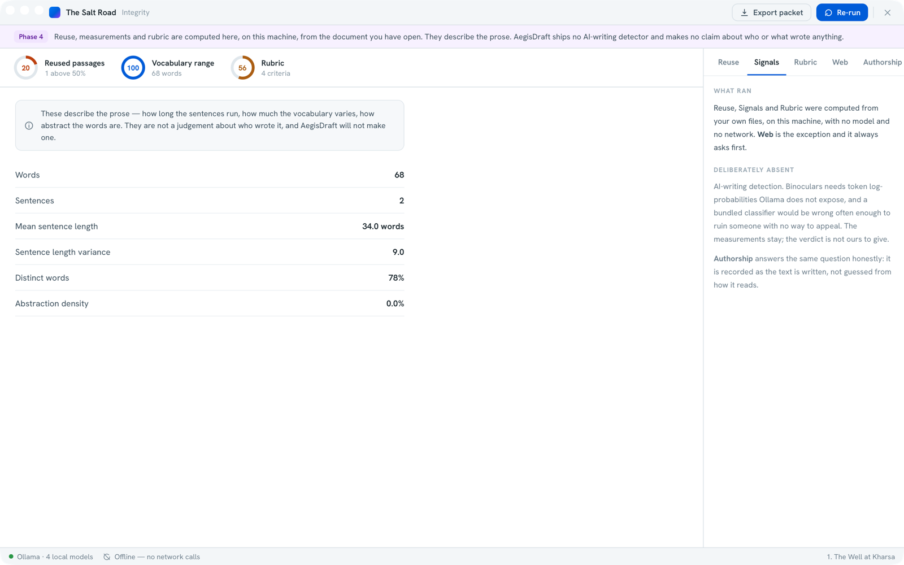

- **Rubric** — four criteria, scored.
- **Web** — phrase-scoped similarity through your own wigolo daemon, confirm-gated,
  every request traced. Off unless you start it (§10).
- **Authorship** — see below.

**Export packet** writes the whole report as JSON + HTML with its method notes,
so a reader can see how a number was produced.

### Authorship, and the detector that is deliberately missing

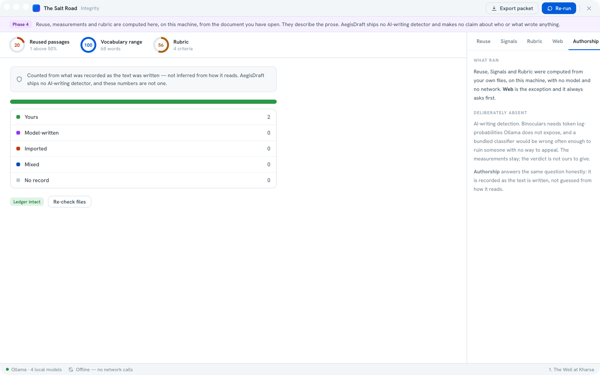

AegisDraft ships **no AI-writing detector**. Binoculars needs token
log-probabilities Ollama does not expose, and a bundled classifier would be
wrong often enough to ruin someone with no way to appeal.

Instead, authorship is **counted from what was recorded as the text was written**:
two paragraphs here, both yours, none model-written. Where there is no record,
the report says *no record* rather than assuming a human wrote it.

---

## 8. Lineage — provenance per paragraph

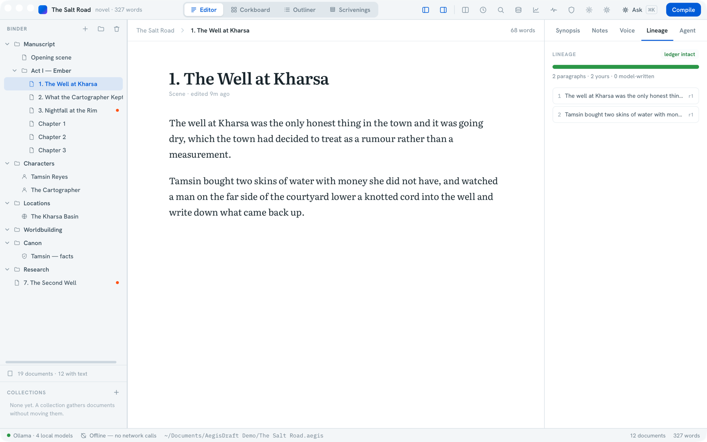

Every paragraph carries a stable id, content-anchored so it survives rewriting,
reordering and editing the file in vim. Each save appends to a hash-chained
ledger in the project: who or what wrote this paragraph, and when.

**Ledger intact** means the chain verifies. It is tamper-*evident*, not
tamper-*proof*: anyone who can write the project database can rebuild the chain.
It tells you something changed, not who changed it.

---

## 9. Story and Insights

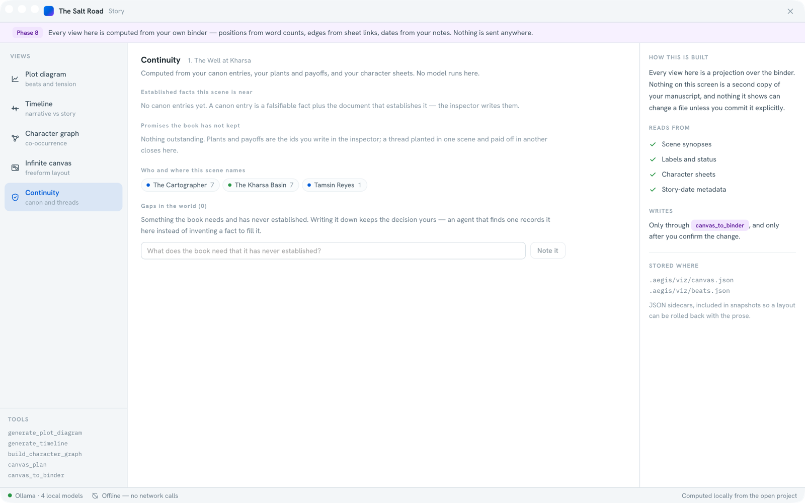

**Story** (five views, all computed from your binder, no model):

- **Plot diagram** — beats and tension against Three act / Freytag / Hero's journey.
  Positions are measured from word counts, not guessed.

  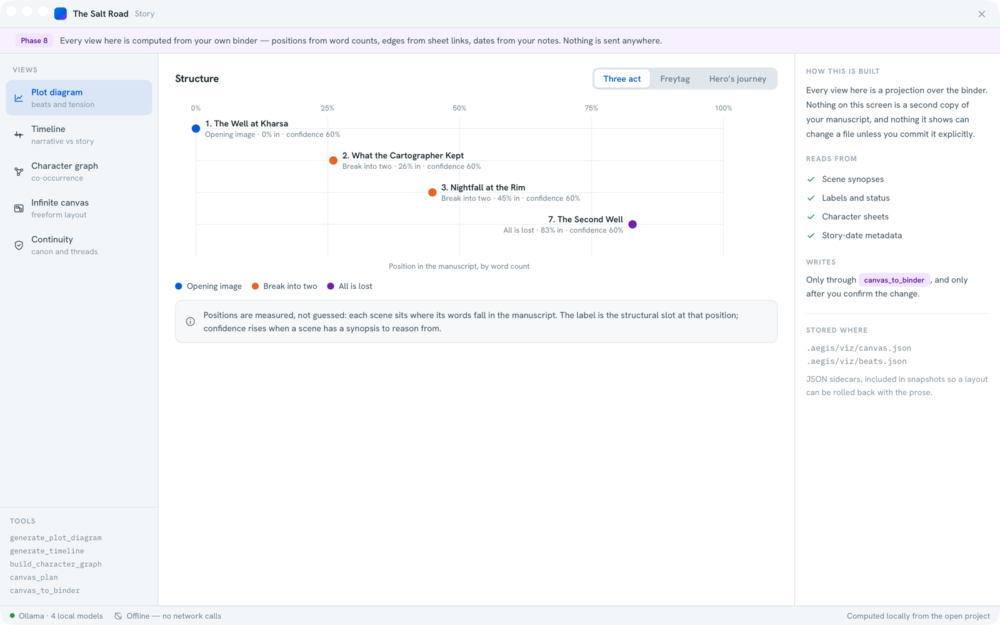

- **Timeline** — narrative order against story order, with gap detection, read
  from the story dates in your notes.
- **Character graph** — co-occurrence, with edges from the links on your sheets.

  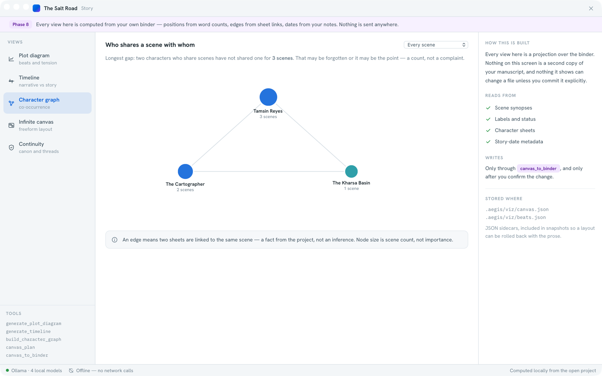

- **Infinite canvas** — freeform layout that can commit a reorder *back* to the
  binder, behind a plan you see first and a snapshot taken before the change.
- **Continuity** — established facts a scene stands near, promises the book has
  not kept, who and where the scene names, and **gaps in the world** you can
  write down instead of inventing a fact to fill them.

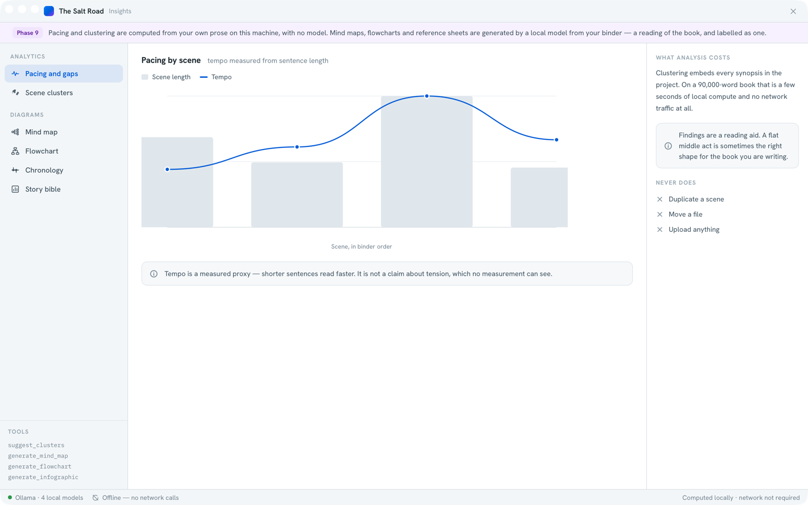

**Insights** — pacing and clustering with no model; mind maps, flowcharts,
chronology and a story bible generated by a local model from the binder,
validated against a strict shape and saved as Markdown with a Mermaid block.

---

## 10. Settings

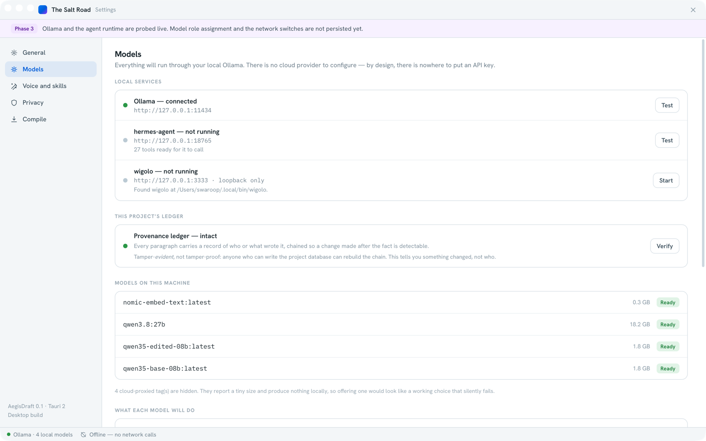

**Models** probes Ollama, hermes-agent and wigolo live, lists the models on this
machine with their sizes, and says what each will be used for. Cloud-proxied
tags are hidden from the local list because they report a tiny size and produce
nothing locally — offering one would look like a working choice that silently
fails. This panel is also where you **Verify** the provenance ledger and
**Start** the wigolo sidecar for web similarity.

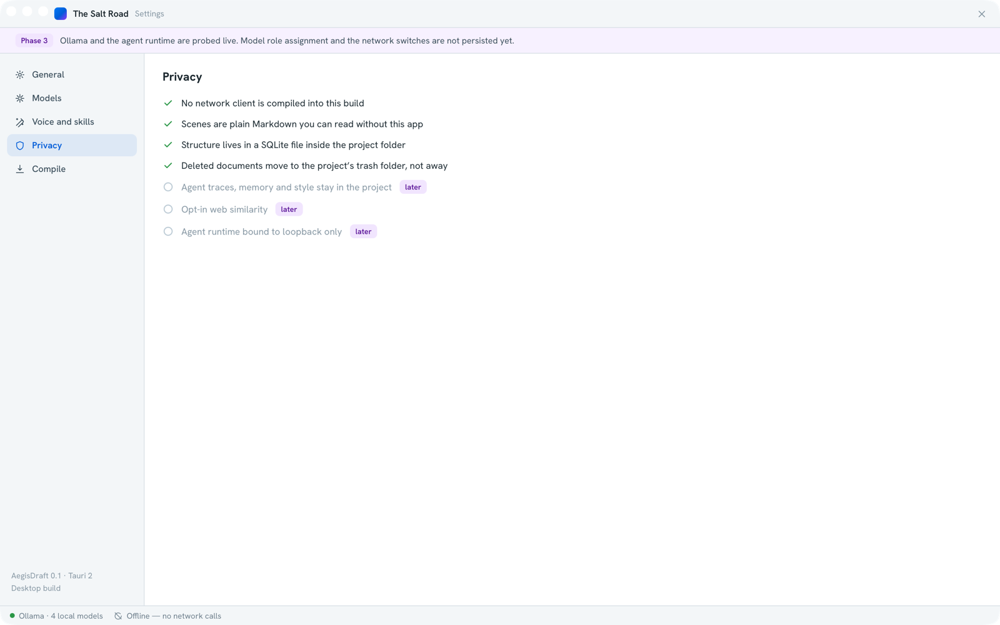

**Privacy** is a checklist of what this build actually enforces, not a
marketing page. Items not yet enforced are greyed and marked *later*.

---

## 11. The Ask bar — agents that do things

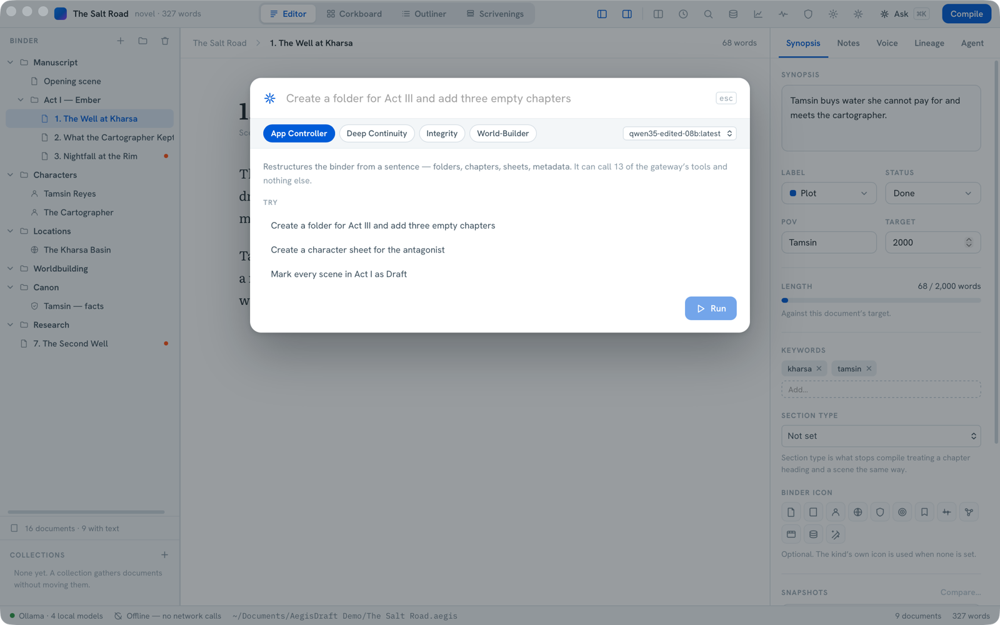

⌘K opens the command bar. Pick a profile, pick a model, describe the work.

| Profile | What it is given |
| :--- | :--- |
| **App Controller** | binder restructuring — folders, chapters, sheets, metadata. 13 of the gateway's tools and nothing else |
| **Deep Continuity** | entity extraction, canon checking, the foreshadowing ledger |
| **Integrity** | the integrity pipeline as a reasoned investigation |
| **World-Builder** | lore generation, saving to the binder, drafting from it |

A profile is a system prompt **plus a tool subset**. A World-Builder that is not
given `delete_document` cannot delete, however it is prompted.

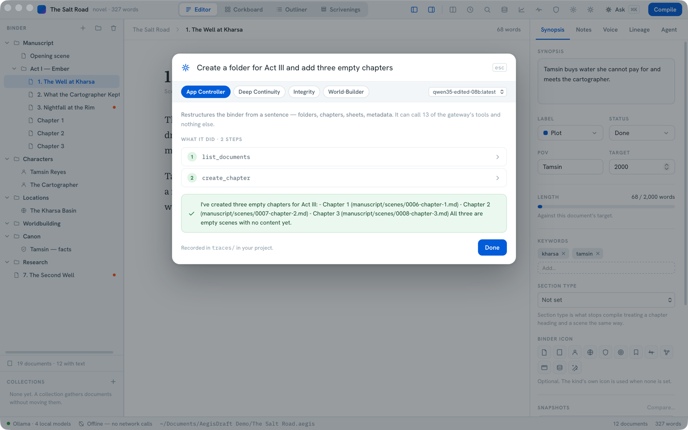

The run shows every step it took. Here it called `list_documents`, then
`create_chapter`, and three chapters appeared in the binder — document count 16 →
19 — while the dialog was still open. Every run is written to `traces/` in your
project as readable JSON.

### When it must ask

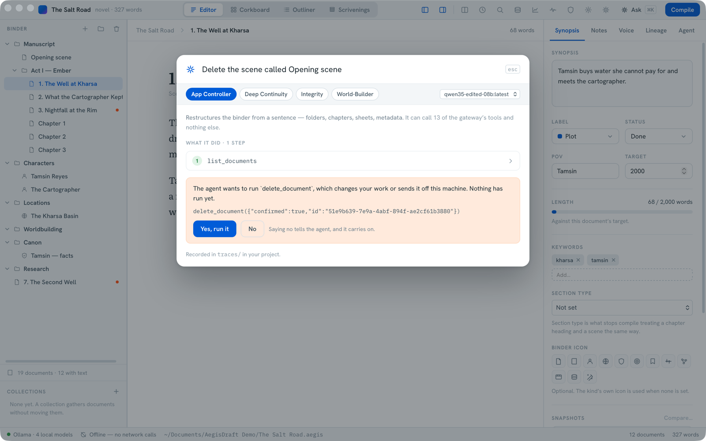

A guarded tool **pauses the run with nothing executed** and shows you the exact
call it wants to make. Declining feeds the refusal back to the model, which then
carries on or stops.

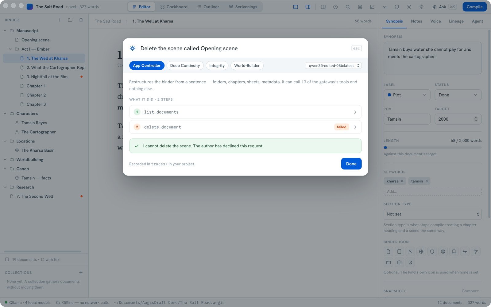

*"I cannot delete the scene. The author has declined this request."* The step is
marked **failed** and the file is still on disk.

---

## 12. Research — sources, claims and evidence

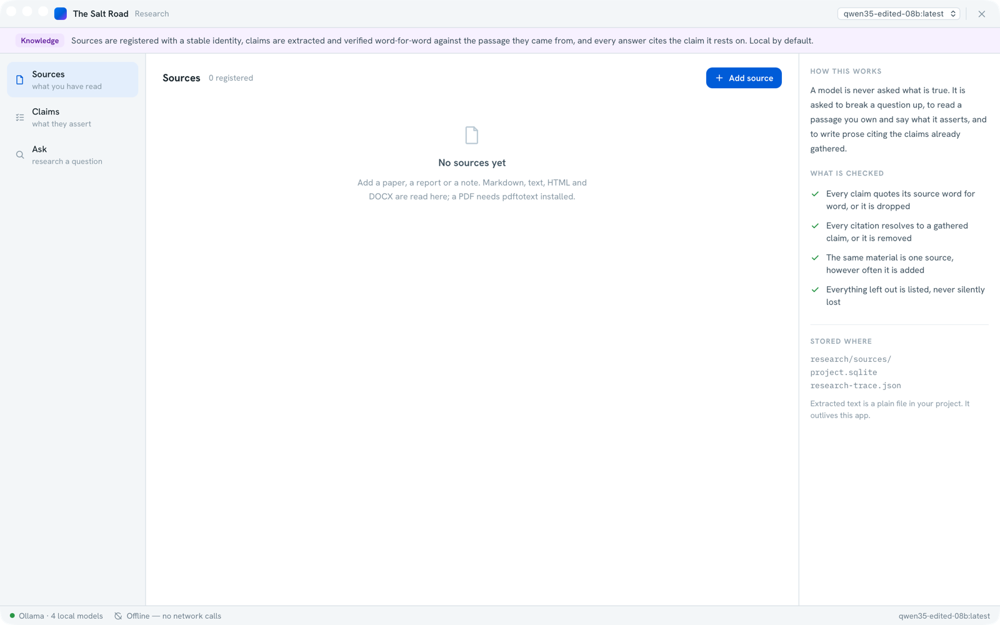

Register what you have read; claims are extracted and verified **word-for-word**
against the passage they came from; answers cite the claim they rest on.

- A model is never asked what is true. It is asked to break a question up, to
  read a passage you own and say what it asserts, and to write prose citing
  claims already gathered.
- Every claim quotes its source word for word, or it is dropped.
- Every citation resolves to a gathered claim, or it is removed.
- The same material is one source, however often it is added.
- Everything left out is listed, never silently lost.

Extracted text is a plain file under `research/sources/`. It outlives this app.

---

## 13. Compile

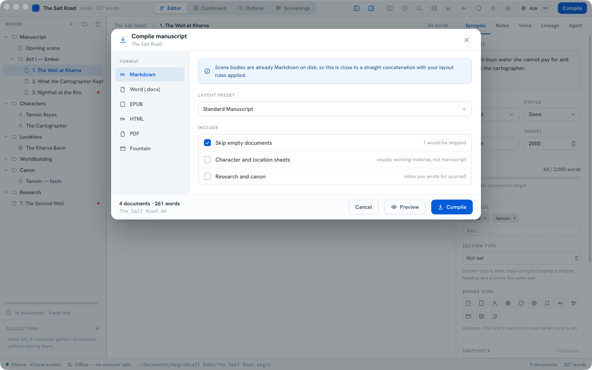

Markdown, Word (.docx), EPUB, HTML, PDF and Fountain, with layout presets and
include filters. The footer counts exactly what will be written before you write
it — *4 documents · 261 words*.

PDF exports print-ready HTML and lets the OS print pipeline make the file; this
build does not bundle a typesetting engine. Archives (.docx, .epub) are verified
by unzipping them in the test suite.

---

## 14. Snapshots

The clock button takes a snapshot of the project (LibGit2, inside the project
folder). The inspector's **Compare…** shows a paragraph-level diff between any
snapshot and now, and restores from one. Agents that do bulk binder writes take
a snapshot first.

---

## 15. Keyboard

| Key | Does |
| :--- | :--- |
| ⌘S | save now |
| ⌘K | Ask bar |
| ⌘B | show/hide binder |
| ⌘I | show/hide inspector |
| esc | close a dialog |

The File menu carries New Project, Open, Import Markdown Folder, New Scene /
Folder / Character / Location, Sheet Templates, Save, Take Snapshot, Compile and
Close Project. Menu items route to the same actions as the buttons — there is one
code path, so both behave identically.

---

## What is not here

Honest list, so nothing in this guide is a promise the build does not keep:

- **No AI-writing detector**, by decision (§7).
- **Web similarity needs wigolo** and is Unix-only; a sandboxed App Store build
  cannot reach it, and the Web tab simply stays unavailable.
- **Images on the canvas** — notes and arrows exist, pasting an image does not.
- **Cross-document block tracking** — a paragraph moved between chapters reads as
  a delete and a create.
- **No publishing channels** (KDP, IngramSpark, Apple Books). That is a
  distribution business, not a local-first authoring one.
