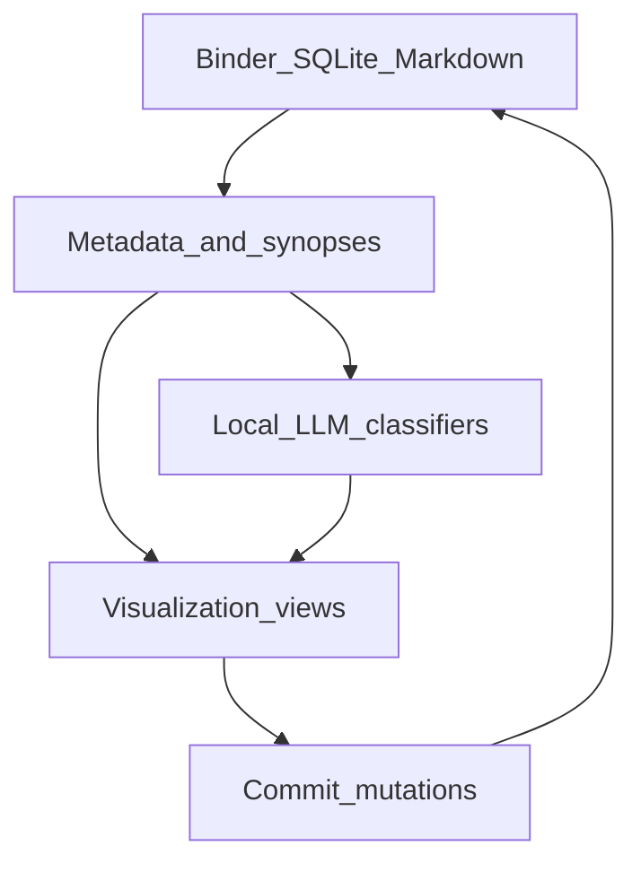

# Phase 8: AI Story Visualization Core (v2)

Purpose: deliver the competitive moat Scrivener deliberately skips—AI-powered plot diagrams, dual-order timelines, character graphs, and an infinite canvas—as **views** over binder metadata. Status: **not started**. Months 15–16. Parent: [ROADMAP.md](../ROADMAP.md). Depends on Phase 2 metadata and Phase 3 Ollama/RAG. Does not edit phases 01–05.

## Goals

- **Plot diagram**: local LLM classifies synopses into story beats (3-act / Freytag / Hero’s Journey) with target overlay
- **Timeline**: toggle narrative order vs story chronology; surface gaps and anachronisms
- **Character relationship graph**: nodes from sheets + co-occurrence; filter by act
- **Infinite canvas**: Miro-style freeform layout with **Commit canvas to binder**
- Visualizations are read-only projections unless an explicit commit tool mutates the binder

## Architecture

Binder and Markdown remain source of truth. Visualization state (canvas positions, filters) is stored as JSON sidecars under the project and tracked by LibGit2 snapshots.

Suggested frontend libs (document-only): React Flow / D3 / Vis.js / tldraw or Excalidraw for canvas.

## Checklist

### Plot diagram

- [ ] Ingest chapter/scene synopses (and optional beat-sheet metadata)
- [ ] Local LLM classifies beats: exposition, rising action, climax, resolution (and/or 3-act, Hero’s Journey)
- [ ] Render SVG or interactive timeline of beat positions + confidence scores
- [ ] Story structure overlay: compare actual beats vs target (e.g. Save the Cat–style positions)
- [ ] Pacing cue: highlight flat stretches in rising action
- [ ] Tool: `generate_plot_diagram(method) -> dict`

### Timeline

- [ ] Scene metadata fields for story date/time (optional)
- [ ] Toggle **narrative order** (binder) vs **chronological** (story time)
- [ ] Dual-lane view: story chronology vs chapter order
- [ ] Gap detection (“N days/months unaccounted for”) and simple anachronism flags
- [ ] Tool: `generate_timeline(mode: chronological | narrative) -> list`

### Character relationship graph

- [ ] Nodes from character sheets; size by screen time / scene count
- [ ] Edges from co-occurrence, keywords (conflict/alliance), or explicit relationship metadata
- [ ] Filter by act / label range; color by faction if present
- [ ] “Stale relationship” hint: edges with no scenes in N pages (stretch)
- [ ] Tool: `build_character_graph(filters) -> graph payload`

### Infinite canvas

- [ ] Freeform spatial cards for scenes, notes, images, arrows
- [ ] Beyond Phase 6 freeform corkboard: true infinite whiteboard (notes + drawings)
- [ ] Persist canvas JSON sidecar; include in LibGit2 snapshots
- [ ] **Commit canvas to binder**: spatial order/clusters → hierarchical reorder or collection
- [ ] Tool: `canvas_to_binder(canvas_state) -> BinderMutation`

### Tool readiness

- [ ] Register Phase 8 tools in sidecar schemas ([TOOLS.md](../TOOLS.md#v2-tools))
- [ ] App Controller can open viz views and run generate_* without menu diving

## Acceptance criteria

- From synopses alone, plot diagram labels major beats with visible confidence; overlay shows intended vs actual
- Timeline toggle switches binder order ↔ chronological without moving files
- Character graph updates when a new scene co-occurrence is indexed
- Author rearranges cards on canvas and **Commit** reorders or groups binder items as confirmed
- All generation runs fully offline via Ollama

## Out of scope

- Mind maps, flowcharts, story-bible infographics, clustering (Phase 9)
- Compile (Phase 7)
- Editing Phase 2 corkboard checklist text

## Competitive note

Scrivener is intentionally non-AI. Phase 8 marketing wedge: *Scrivener-class studio with AI-powered story visualization*—plot, timeline, and character graph as daily drivers.
