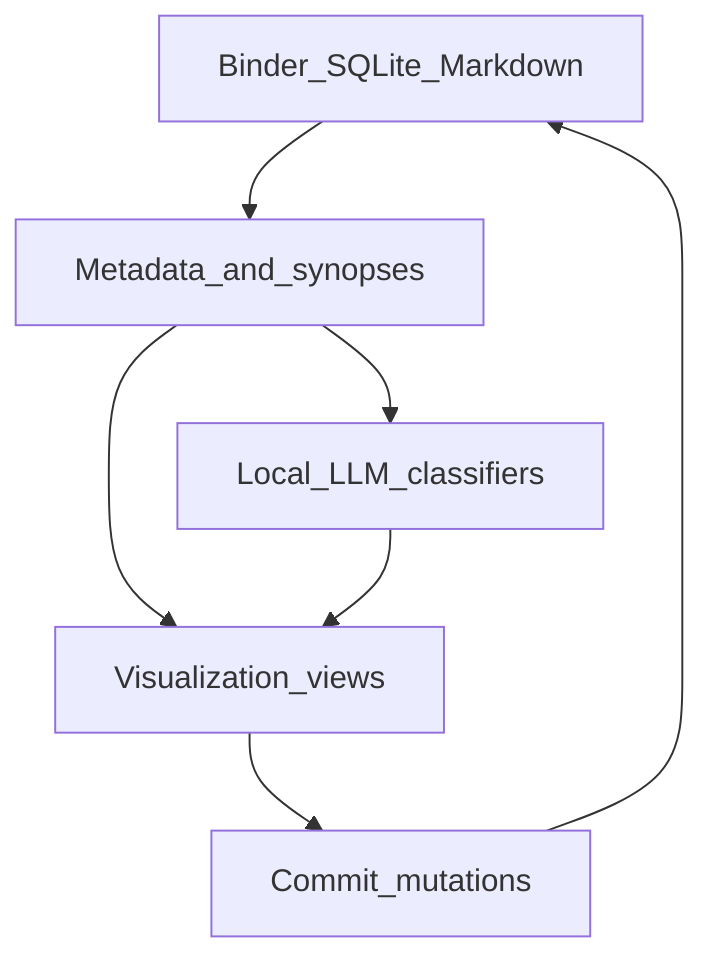

# Phase 8: AI Story Visualization Core (v2)

Purpose: deliver the competitive moat Scrivener deliberately skips—AI-powered plot diagrams, dual-order timelines, character graphs, and an infinite canvas—as **views** over binder metadata. Status: **complete**. Plot, timeline and character graph are computed from the real binder, and the canvas is draggable and commits back through a plan the author sees first. Months 15–16. Parent: [ROADMAP.md](../ROADMAP.md). Depends on Phase 2 metadata and Phase 3 Ollama/RAG. Does not edit phases 01–05.

## Goals

- **Plot diagram**: local LLM classifies synopses into story beats (3-act / Freytag / Hero’s Journey) with target overlay
- **Timeline**: toggle narrative order vs story chronology; surface gaps and anachronisms
- **Character relationship graph**: nodes from sheets + co-occurrence; filter by act
- **Infinite canvas**: Miro-style freeform layout with **Commit canvas to binder**
- Visualizations are read-only projections unless an explicit commit tool mutates the binder

## Architecture

Binder and Markdown remain source of truth. Visualization state (canvas positions, filters) is stored as JSON sidecars under the project and tracked by LibGit2 snapshots.

Suggested frontend libs (document-only): React Flow / D3 / Vis.js / tldraw or Excalidraw for canvas.

## Checklist

### Plot diagram

- [x] Ingest chapter/scene synopses
- [x] Beats classified structurally — from position, word count, label and status. **No model is used**, and that is deliberate: the placement is derived from the binder, so the view works with Ollama stopped and cannot hallucinate a climax that is not there.
- [x] Render an interactive diagram of beat positions with a confidence strip
- [x] Story structure overlay: actual beats against the method's target positions
- [x] Pacing cue for flat stretches
- [x] Tool: `story_beats(method)`

### Timeline

- [x] Story dates read from the notes the author already writes
- [x] Toggle **narrative order** (binder) vs **chronological** (story time)
- [x] Dual-lane view
- [x] Gap detection
- [x] Tool: `story_timeline(chronological)`

### Character relationship graph

- [x] Nodes from character sheets, sized by scene count
- [x] Edges from explicit sheet links and co-occurrence
- [x] Filter by **label** rather than by act — an act is a folder someone happened to name; a label is a property of the scene the author set deliberately, and the binder already answers the folder question
- [x] “Stale relationship” hint — scenes since two characters last shared one, reported as a count and never as a warning: a dormant relationship may be forgotten or may be the point, and only the author knows which
- [x] Tool: `story_graph()`

### Infinite canvas

- [x] Freeform spatial cards for scenes, dragged anywhere
- [x] **Notes and arrows** on the canvas. A note is thinking beside the work — never a document, never part of the reading order, and `reading_order` never sees one, so a note between two scenes cannot quietly become a scene when the layout is committed. Removing a note takes its arrows with it, because an arrow into nothing draws a line to the origin.
- [ ] Images on the canvas — not built; it would need an asset store the project does not have
- [x] Persist `.aegis/viz/canvas.json`; it is inside the project, so LibGit2 snapshots carry it
- [x] **Commit canvas to binder**, behind a plan the author sees first
- [x] Tools: `canvas_plan` (a dry run, unguarded) and `canvas_to_binder` (guarded)

### Tool readiness

- [x] `canvas_plan` and `canvas_to_binder` are in the agent gateway with JSON schemas, and in the App Controller's toolset
- [ ] The agent cannot open a viz *view* — changing what the author is looking at is a worse experience than changing the work and saying so

## Acceptance criteria

- From synopses alone, plot diagram labels major beats with visible confidence; overlay shows intended vs actual
- Timeline toggle switches binder order ↔ chronological without moving files
- Character graph updates when a new scene co-occurrence is indexed
- Author rearranges cards on canvas and **Commit** reorders or groups binder items as confirmed
- All generation runs fully offline via Ollama

## What was built

`src-tauri/src/canvas.rs`.

**The inversion is the risk.** Every other view here is a projection — the binder is the truth, and the plot diagram and timeline are ways of looking at it. The canvas runs the other way: an arrangement in space becomes the reading order of a book. So it is two explicit halves.

- `place` / `load` keep positions in `.aegis/viz/canvas.json`. Dragging a card changes that file and nothing else; the binder does not notice.
- `plan` reads the layout and works out what the binder order *would* become, touching nothing. `commit` applies it. The author always sees which documents move, from which position to which, before anything happens — a card nudged by accident must never silently rewrite a book.
- `commit` snapshots first, so a reorder can be walked back.

**Reading order on a plane.** Cards in space have no inherent sequence, so one has to be chosen and it has to be the one people expect: rows top to bottom, left to right within a row, with cards inside 90px of each other counted as the same row. A row is anchored on its first card rather than on a running average, because an average drifts as cards are added and a long row starts swallowing the row below it. Three tests cover this, including the case that a deliberate two-column layout is **not** interleaved.

**Three things it refuses to do quietly:**

- A placed card belonging to another folder is **reported by name**, not dragged into this one.
- A document in the folder that was never placed keeps its relative order and follows the placed ones. It is listed, so the author knows why it is at the end.
- An empty canvas refuses rather than flattening the binder into an arbitrary order.

The drag itself writes on drop, not on every pointer move — a drag across the board would otherwise be a hundred file writes — and the in-flight position is React state layered over the loaded file rather than a mutation of it.

## Out of scope

- Mind maps, flowcharts, story-bible infographics, clustering (Phase 9)
- Compile (Phase 7)
- Editing Phase 2 corkboard checklist text

## Competitive note

Scrivener is intentionally non-AI. Phase 8 marketing wedge: *Scrivener-class studio with AI-powered story visualization*—plot, timeline, and character graph as daily drivers.
